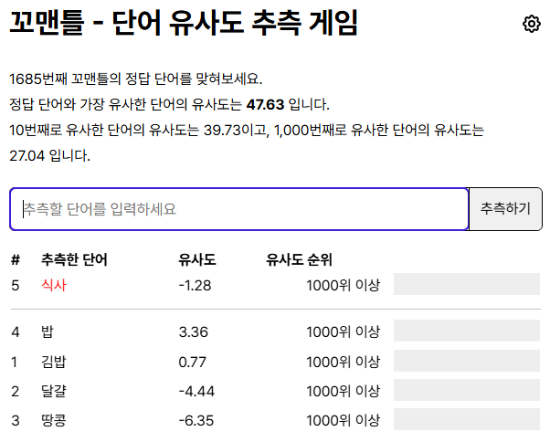

📅 2026-11-05 · AI 이해하고 사용하기 02

재미나이에 긴 페이지를 붙여넣고 대화했다.
대화 중간중간 맥락을 놓치는 기분이 들고, 대화가 연결되지 않았다.
무료 버전이어서 그런가, 페이지 내용이 길어서 그런가?
**내가 중요하다고 생각하는 거랑 다른 걸 중요하다고 생각하기도 하고.**

오늘 수업이 딱 이 질문에서 출발했다.

> **3줄 요약**
> - 언어 모델은 글을 **토큰**으로 쪼개고, 토큰끼리 서로 비춰 보는 **어텐션**으로 다음 토큰을 하나씩 이어 쓴다.
> - 토큰이 2배가 되면 서로 비교하는 계산은 **4배 가까이** 는다. 같은 뜻이어도 한국어는 토큰을 더 쓴다.
> - 많이 넣는다고 다 쓰는 게 아니다. 긴 입력의 **중간**은 놓치기 쉽다.

## 재미나이가 무료여서 그런가?

재미나이와 대화가 길어지면 맥락을 잃어버리고.
중요한 내용을 빼먹거나 엉뚱한 이야기를 하는 경우도 있다.
중간중간 새 대화로 갈아탄다.
무료여서 그런가?(버전이 낮으니까 조금 떨어지는 모델이니까?)

그런데 이 곤란은 "AI가 멍청해서" 생기는 일이 아니라고 한다.

## 이미지가 먼저 연 길

- CNN, 픽셀에서 신경망이 학습(수표 판독기로 상용화)
- 지원군, ReLU와 dropout
- ResNet이 만든 지름길: 잔차 블록

## 잔차는 귓속말

- 층을 깊이 쌓을수록 **학습 신호가 흐려짐** (기울기 소실)
- 잔차 연결은 입력을 **지름길로 그대로**, 층은 **고칠 부분만** 더하기
- 덕분에 **152층** ResNet도 학습

잔차 연결이 어려웠다. 골목길을 뚫는 기분으로 이해했는데..
특정 가중치를 넘어가는 값은 그대로 보낸다? 그래서 기울기 소실을 해결한 건가?
개념이 어렵다기보다는 **잔차라는 단어가 더 어렵게 만든 거 같다.**

찾아보니 문턱(특정 결과값)은 없었다. ㅡ,.ㅡ;
귓속말과 함께 **원본 쪽지**(지름길로 가는 입력)를 같이 돌리고, 각자 고칠 메모 한 줄만 덧붙이는 게 잔차 연결이다.

## 유사도 게임: 바다 옆 버그

- 단어는 **숫자 묶음**(벡터)으로, 가까운 정도는 **코사인 유사도**로
- 배운 건 사전 뜻이 아니라 **쓰임의 이웃 관계**
- 유사도는 -1과 +1 사이의 값

수업에 꼬맨틀(유사도 게임)이 나왔다.
내가 단어를 적는 수준으로는 못 맞추겠더라. ㅎㅎㅎ

실습은 정답 '바다'에 후보 단어 27개를 줄 세우는 유사도 게임.

그런데 결과에 **버그가 8위**로 나왔다. 음?

AI가 정한 단어 간 유사도는 국어 시간에 공부한 유사한 의미와 다르다.
(사람들이 많이 연결해서 쓰는 단어 간 관계)
내 생각엔 외국 어딘가에서 "버그의 바다"라는 말을 했을 거 같다.
셀 수 없이 많으면 바다라고 느껴질 거다.

근데 좀 징그럽다. ㅎㅎㅎㅎ

## "학교"의 뜻은 옆 단어로

2017년 트랜스포머의 핵심은 어텐션이다. 도서관으로 치면 이렇다.
- **Q(쿼리)** 내가 찾는 것 / **K(키)** 책등의 라벨 / **V(밸류)** 책 속 내용
- 모든 토큰이 **동시에** 하니까 **병렬 계산** 가능 (순서대로 읽던 RNN과 차이)

학교라면 학교가 쿼리가 되고,
밸류는 학생들이 공부하는 학교, 감옥에 가는 어른들의 학교(ㅋㅋㅋ), 초등학교, 중학교... 이런 건가?

아니었다.
QKV는 같은 문장 안의 토큰끼리 주고받는다.
"학생들이 학교에 간다"에서 '학교'는 '학생'의 정보를 받아 와서 학생이 다니는 학교가 된다.

아 그래서 수업 때 Q/K/V를 그때그때 만든다고 한 거구나!

트랜스포머가 병렬처리를 하면서 단어를 분해 분석해서 끄집어낸다고 했는데,
내가 이렇게 이야기하면 클로드가 내 말 이해하는 데 얼마나 힘들까. 그런 생각 했다.

근데도 꾹 참고 잘 대답해 주는 거 보면 신기하다 ㅎㅎㅎ

## 결국 컴퓨팅 파워

트랜스포머는 원래 번역기였다. 그게 지금의 챗봇이 되기까지 세 번 뛰었다.
- **사전학습**: 인터넷 글로 다음 토큰 맞히기 반복
- **스케일링**: 모델·데이터·계산량을 키우면 성능도 **예측 가능하게** (2020 스케일링 법칙)
- **정렬**: 사람이 모범 답과 선호를 알려 줘서 **말귀 알아듣게** (SFT, RLHF)

기계번역에 가까운 거 같다고 느꼈는데, 진짜 번역기에서 시작했다.
단순히 많이 학습시켜서 말을 시키니까 말을 한다,
신기하다. 구글파워

컴퓨팅 파워처럼 느껴졌다.
AI 역사가 70년쯤인데, 하드웨어가 성능이 올라가도 그걸 활용할 소프트웨어가 없거나,
소프트웨어를 만들었는데 받쳐 줄 하드웨어가 없거나.
행렬곱을 GPU 병렬 연산으로 처리한다는 아이디어를 꺼내지 못했다면,
AI랑 대화하면서 내가 배울 수 있는 게 50년은 밀리지 않았을까.

## 토큰을 더 먹는 한글

- **토큰**은 비용과 속도를 세는 단위
- 토큰이 2배면 비교 계산은 **4배 가까이** (요금까지 4배는 아님)
- **컨텍스트 윈도우**는 한 번에 펼치는 작업대, 크다고 **검토가 쉬워지진 않음**

"계약 기간은 체결일로부터 1년으로 하며, 자동 갱신됩니다."
"The contract term is one year from the date of execution, with automatic renewal."

| 같은 뜻의 계약 문장 (교재 예시, GPT 방식) | 한국어 | 영어 |
|---|---|---|
| 글자 → 토큰 | 32자 → 22토큰 | 81자 → 16토큰 |
| 토큰 하나에 든 글자 | 1.45 | 5.06 |

글이 길어지면 연산 개수가 많아져서 곱절로 늘겠다 정도로 생각했다.
이 실습은 직접 돌려 보지는 않았다. 노트에 결과가 있어서. 퍼실님이 아티팩트로 만든 걸로 수업 들었다.

한글이 토큰이 많이 드는 건 utf-8 문제라고 생각했는데,
다시 보니 한글을 잘 이해 못 해서 토큰을 이상하게 나눈 거네.
'갱' 한 글자가 깨진 조각 두 개로 갈라져 있었다.
(찾아보니 둘 다 맞다. 글자를 UTF-8 바이트로 다루는 데서 시작하고, 한국어를 덜 본 토크나이저는 그 바이트를 덜 합친다.)

그리고 다시 재미나이.
긴 입력에서 맨 앞과 맨 뒤는 잘 쓰는데, 중간 정보는 놓치기 쉽다는 연구가 있다. ("Lost in the Middle", Liu 외, 2023)
내 기분 탓만은 아니었나 보다.

## 회고: 그래도 구글

2017년 논문 "Attention Is All You Need"
오늘 한 줄, **"구글 대다나다"** ㅋㅋㅋㅋ

아무것도 없는데 갑자기 뿅 하고 나온 건 아니었지만,
아인슈타인도 특허 심사하면서 이것저것 많이 봤다는 후문처럼.

---

**아이펠 AI 에이전트 3기 AI 이해하고 사용하기 기록**
1. [AI이해-01 AI는 어떻게 배우나](/blog/aiffel/ai-use-01-learning-from-data-2026-11-04/)
2. **AI이해-02 트랜스포머와 토큰** ← 지금 글
