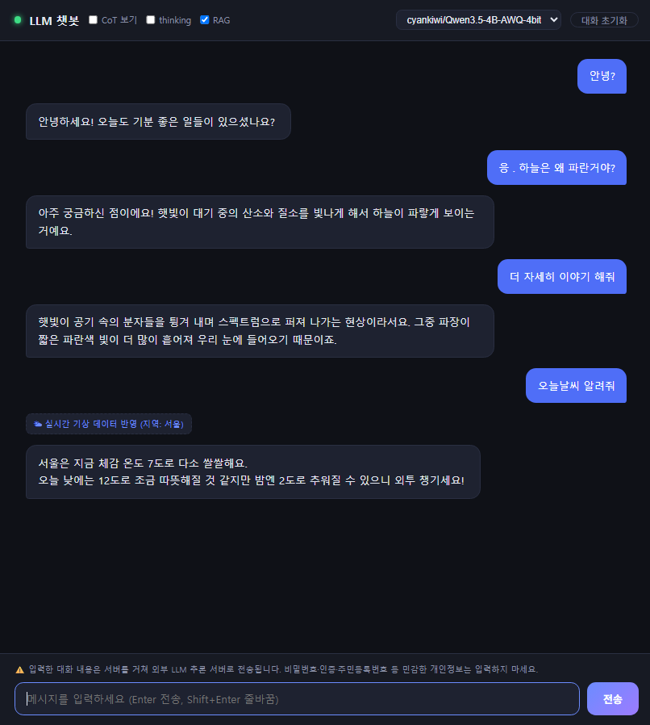

📅 2026-11-09 · AI 이해하고 사용하기 03

나: 너는 뭘 할 수 있어?
llama3.2: 나도 많은 Things를 할 수 있습니다!
llama3.2: English와 한국어를 nói고 이해할 수 있습니다.

내 노트북에 받아 둔 llama3.2와 나눈 대화다.
한국어로 물었는데 영어, 베트남어, 한자, 태국어까지 섞여서 돌아왔다.
이날 수업은 이런 LLM을 내 컴퓨터에서 돌릴지, 남의 서버를 빌릴지 고르는 법이었다.

> **3줄 요약**
> - 모델을 **만드는 일**(학습)과 **쓰는 일**(추론)은 비용이 다르다. **양자화**로 눈금을 줄이면 노트북에도 들어간다.
> - **API를 쓴다 ≠ 외부로 보낸다.** 실행 위치는 **데이터·비용·통제권**을 함께 따져 고른다.
> - 청구서가 0원이어도 **무료는 아니다.** 전기, 시간, 그리고 다음 날 아침 꺼진 서버.

## 이미 내 노트북에 있었다

- **학습**(만들기)과 **추론**(쓰기)은 비용 구조가 다르다
- 추론에도 **메모리의 벽**은 남는다. 7B 모델은 가중치만 약 14GB (교재 기준)

"수백만 달러로 만든 모델이 60만 원짜리 그래픽카드에서 돈다"는 말로 수업이 시작됐다.
이미 올라마로 llama3.2를 받아 둬서 큰 감흥은 없었다.
가벼운 모델도 많은데, 0.8B 같은 게 있는 줄은 몰랐다.
그런데 그걸로 어떤 일을 시킬 수 있을까? 하는 고민이 들었다.

내 노트북은 i5 10세대에 RAM 16GB.
그래서 수업 따라가기가 벅차다.

잽(ZEP)만 연결해도 컴터가 버벅거린다 ㅜㅡㅜ

## 눈금은 이미 줄어 있었다

- **양자화**: 가중치를 적는 눈금을 성기게 해서 저장 공간을 줄이는 일. 16비트를 4비트로 바꾸면 대략 4분의 1
- **GGUF**: 가중치와 어휘 등을 파일 하나에 담는 형식
- 어림 계산: 4비트면 **파라미터 수(B) × 0.5GB** + 캐시 + 여유 (교재 기준)

수십억 개 숫자를 거칠게 적었는데, 왜 문장이 무너지지 않을까?
교재가 던진 질문이다. 파일은 크게 줄었는데 점수는 아주 조금 내려갔다는 비교도 나온다.

양자화는 수치를 조금 큰 단위로 바꾸는 거 정도로 알고 있었다.
그러다 내 llama3.2가 궁금해서 쳐 봤다.

```
> ollama show llama3.2
    architecture        llama
    parameters          3.2B
    context length      131072
    quantization        Q4_K_M
```

이미 4비트로 양자화된 걸 쓰고 있었다.
3.2B × 0.5GB면 가중치만 약 1.6GB. 16GB 노트북에 들어갈 만하다.

오우 이런 게 있는지 몰랐네.

## 6시간, 20커밋짜리 챗봇

- 1단계: **로컬 Ollama**로 0.8B 모델과 대화
- 2단계: **코랩 T4 + vLLM**으로 4B(4비트) 모델을 서버로 띄워 호출
- 큰 모델이 항상 더 낫다고 단정하지 않기

0.8B는 받아서 써 보니 llama3.2와 비슷한 것 같아서 지웠다.
대신 2단계에 꽂혔다.
LLM은 무거운데, 코랩에 올려서 API로 만들 수 있다니까.
예제가 이미 있어서 그걸로 코랩에 LLM을 띄웠다.

그날 저녁, 내 노트북에 챗봇 화면을 붙였다.
17:46 첫 버전부터 23:23까지 20커밋.
스트리밍 채팅, 생각 과정 보기, 웹 검색, 날씨, 서버 상태 점까지 붙었다.



분명 모델은 구글 서버에서 도는데, 왜 내 컴퓨터가 무거워질까?
계산은 구글이 하지만, 보여 주는 일은 내 노트북이 한다.
코랩 서버 로그가 계속 올라와서, 이력이 남는 건 좋은데 힘들더라 ㅎㅎ

크롬 `Shift+Esc`(탭별 메모리 보기)도 이번에 처음 알았다.
평소 탭을 20개쯤 띄워 두는데, 느려질 때마다 안 쓰는 거 있나 확인하고 닫는다 ㅋㅋㅋ

## 이렇게 하는 게 맞나?

- 갈래는 셋: **공개 API / 관리형 배포 / 로컬·자체 운영**
- **OpenAI 호환 API**: 주소만 바꾸면 실행 장소를 옮길 수 있다
- **API를 쓴다 ≠ 외부로 보낸다.** 내 서버도 API를 줄 수 있다

내 챗봇도 OpenAI 형식으로 부르지만, 받는 쪽은 내가 띄운 코랩 서버다.

만들면서 애먹은 건 줄줄이 이어졌다.
상냥한 챗봇을 만들려다 보니 시스템 프롬프트가 길어졌다.
생각 과정까지 나오니 답이 너무 오래 걸려서 토글을 만들었다.
오늘 날씨를 물었는데 잘 안 돼서 RAG를 붙이고 토글을 만들었다.
날짜와 지금 시간으로 인사하려고 시간 정보를 가져왔다.
RAG가 켜 있더라도 검색이 필요 없는 일반 대화에서의 사용 여부는 랭체인으로 구분시켰다.

한국어 표현도 골칫거리였다.
첫 문단의 llama3.2처럼 여러 나라 글자가 섞여 나왔다.
그래서 프롬프트, 글자 필터, 자동 재생성을 겹쳐 넣었다. (내가 붙인 이름은 "토큰 드리프트")

(찾아보니 연구에서는 **언어 혼동**(language confusion)이라 부르고, Llama 계열에서 특히 심했다고.
프롬프트로는 **일부**만 줄일 수 있다고 한다. 2024년 논문 기준)

그래서 필터까지 겹쳐 둔 게 잘한 거였다 ㅎㅎ

나는 한국어만 듣고 자라서 영어를 조금 하는데, AI는 모든 언어를 다 안다.
그래서 대단하다.

생각보다 간단하게 만들어지는 게 아니었다.

이렇게 하는 게 맞는 건가? 이렇게 해도 되나?

## 문장 하나가 지나는 길

- **"학습에 안 쓴다" ≠ "남지 않는다".** 로그 보관, 리전, 계약은 따로 확인
- 판단은 **전송 전에**
- 문서 하나의 길을 **입력 → 전송 → 추론 → 로그**로 짚어 보기

내 챗봇에서 문장 하나가 지나는 길은 이렇다.
브라우저 → 내 노트북 중계 서버 → ngrok → 코랩(구글) 서버.
RAG를 켜면 질문이 검색 엔진으로도 가고, 지역을 알려고 IP도 조회한다.

채팅 내용이 외부 서버로 나가는 건 맞으니까, 화면 아래에 고지문을 달았다.
https더라도.

IP 조회는 내 컴퓨터가 아니라 내가 쓰는 인터넷 망의 끝부분이라, 대략적인 위치만 알 수 있다.
대부분의 웹서비스도 요청 IP는 기본으로 남긴다.
다만 교재에 이름을 지워도 다른 정보와 합치면 사람을 알아볼 수 있다는 말이 있다. 그래서 IP도 개인정보로 다루는 경우가 있다.

오히려 더 조심한 건 따로 있었다.
깃헙 퍼블릭으로 프로젝트를 만드니까, API 주소가 설정 파일 말고 소스에 들어가는 걸 더 조심했다.
보안, DevSecOps에 관심이 많다.

## 절대 0원 아니었지

- **청구서가 없다고 비용이 없는 것은 아니다**
- 로컬 비용은 **장비·전기·사람의 시간**으로 나뉜다
- **남의 손익분기 숫자**는 그대로 가져올 수 없다. 교재는 그 이유를 세 가지로 든다

과제는 "추가 이용료 0원으로 도는 기능"을 만드는 거였다.
내 챗봇도 추가 이용료는 0원이었다.

절대 0원 아니었지 ㅎㅎㅎ
내 전기세, 교육용 클로드 사용량, 교육비, 노트북 마모도.
0원으로 쓰려고 익힌 여러 추가 지식과 활용법까지.

교육비와 클로드 사용량은 이미 낸 돈이니까,
내가 더 열심히 공부해서 내 껄로 만들어야지 ㅎㅎㅎ

## 반년이 아니라 다음 날 아침

- 통제권은 세 질문: **누가 바꾸고, 누가 멈추고, 누가 설명하는가**
- 통제권 문제는 "반년쯤 뒤 아무 일 없던 화요일 아침"에 온다 (교재 표현)
- 직접 운영하면 통제권과 함께 **운영 책임**도 진다

코랩 무료 세션은 안 쓰면 떨어져서, 헬스체크로 계속 깨워 뒀다.
그래도 다음 날 아침, 챗봇은 빈 대답을 찍고 있었다.
제일 처음 든 생각은, 어제 뭐 수정하다 잘못했나? ㅎㅎㅎ

클라우드에 올리는 순간, 그들이 내 서비스를 어떻게 하느냐에 많이 영향을 받는다.
무료 정책, 사용량에 따른 차단, 트래픽 이슈.
빈 대답 대신 서버 장애 안내가 뜨게 고쳤다.
서버는 다시 올리지 않았다.

다시 올릴 기력이 없었다. 에너지 고갈이었다 ㅎㅎㅎ

## 회고: 돈이 없다?

- 오늘의 산출물: **추가 이용료 없이 도는 기능 하나**, 그리고 어디서 돌고 왜 0원인지 설명
- 페어에게 자랑하기

과제는 디스코드에 캡처로 올렸다.
다른 친구는 사우론 챗봇을 올렸는데, 눈이 움직일 거 같았다 ㅎㅎㅎ
친구가 남긴 댓글 하나.
"토큰 회복하시면 클로드 코드에게 이것저것 기능 붙여 달라고 졸라 주세요 ㅋㅋㅋㅋ"

오늘 한 줄은... 돈이 없다? ㅎㅎㅎ
무료 코랩, 무료 ngrok, 무료 깃헙, 교육 계정 클로드.
노트북은 부하가 생겨서 느려지고.
맥 사고 싶다. 여러 화면 보게 모니터 사고 싶다. 클로드 상위 계정 쓰고 싶다.

토큰 펑펑 쓰는 친구들 부럽다.

---

**아이펠 AI 에이전트 3기 AI 이해하고 사용하기 기록**
1. [AI이해-01 AI는 어떻게 배우나](/blog/aiffel/ai-use-01-learning-from-data-2026-11-05/)
2. [AI이해-02 트랜스포머와 토큰](/blog/aiffel/ai-use-02-transformer-tokens-2026-11-06/)
3. **AI이해-03 LLM과 로컬 실행** ← 지금 글
