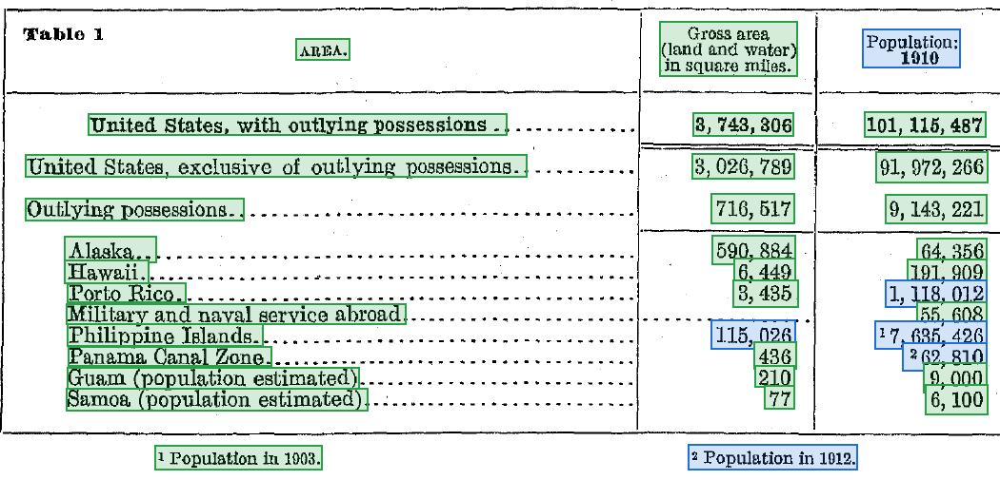
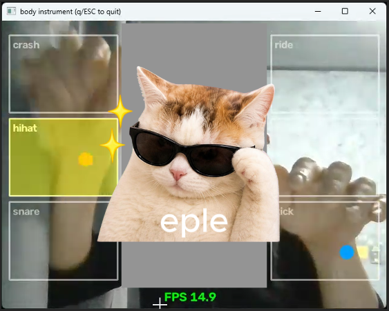
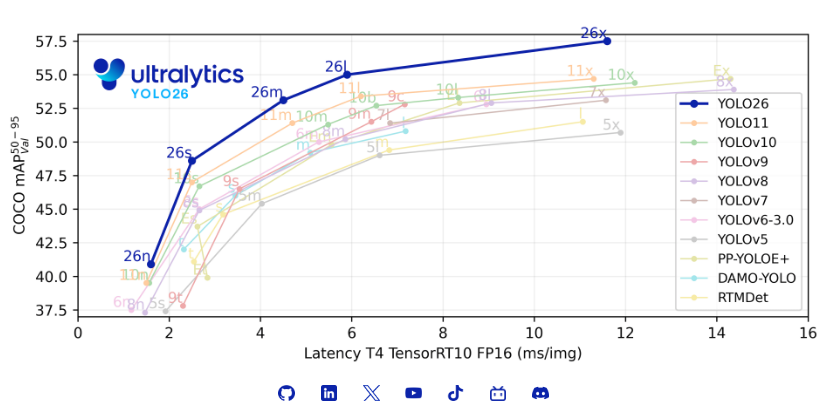

📅 2026-11-10 · AI 이해하고 사용하기 04

```
칸     OCR이 읽은 값        판정
h_c2   Population: 19010   일치
```

원본 표에는 1910이라고 적혀 있다.
자동 비교는 유사도 0.97, "일치"라고 했다.
이날 수업은 AI가 이미지에서 무엇을 읽어 내는지, 그 결과를 어디까지 믿을지였다.

> **3줄 요약**
> - 같은 이미지라도 필요한 답은 **값·위치·경계**로 다르다. 답의 모양이 도구와 검증 방법을 정한다.
> - OCR은 **전처리 → 검출 → 인식 → 레이아웃 분석**으로 이어지고, 앞의 실수는 뒤로 번진다. "대체로 비슷함"은 숫자 한 자리를 놓친다.
> - 임계값을 움직이면 **오탐과 미탐**이 맞바뀐다. 어느 쪽이 더 아픈지는 일이 정한다.

## 사진 한 장, 답은 넷

- 같은 조립 라인 사진에도 팀마다 원하는 출력이 다르다: **좌표·개수·경계·새 이미지**
- 문서에서는 **값**이, 사진에서는 **위치**와 **경계**가 답이 된다
- 도구가 무엇을 내든, 결과를 믿을 책임은 **사람**에게 남는다

조립 라인 사진 한 장이 팀에 따라 원하는 게 달라졌다.
문제를 어느 부분에서 보느냐에 따라, 이미지를 각 팀의 시선에 맞게 전해야 한다.

AI 에이전트가 같이 일하는 팀이 된다면, 이제는 사진 하나를 모두에게 보내는 걸로 끝나지 않는다.
중간에 분석 프로그램이 팀마다 맞는 정보를 나눠 줘야겠다는 생각이 들었다.
물론 원본도 같이 보내서 진위 여부도 판단할 수 있게.

## "1910"이 "19010"이 된 날

- OCR의 네 작업: **전처리 → 검출 → 인식 → 레이아웃 분석**
- 앞 단계의 실수가 뒤 결과로 번지는 **오류 전파**. 그래서 좌표와 중간 결과를 남긴다
- 읽기 어려운 칸은 추측으로 채우지 않고 "**확인 필요**"로 둔다

과제 B는 1910년 미국 인구조사 표 한 장을 Colab에서 PaddleOCR로 읽는 거였다.
OCR에 44.7초, 글자 박스 41개, 복원한 표는 37칸.

그런데 자동 비교가 잘못 읽은 값 4개를 "일치"로 통과시켰다.
`Population: 19010`, 1912를 1012로 읽은 각주, 얼룩을 마침표로 읽은 `1.15, 026`.
글자 유사도나 숫자만 뽑아 비교하는 규칙으로는 걸러지지 않았다.
표에서는 그 한 자리가 핵심인데.

**정밀도**를 최대한 올렸다.
규칙을 "숫자가 정확히 같고 표기도 정상이어야 일치"로 고쳤다.
37칸을 원본에서 잘라 확대해 하나씩 대조했다. 일치 31, 수정 6.
위첨자 각주 1이 숫자 앞에 붙어 7,635,426이 17,635,426으로 읽힌 칸도 있었다.



## 박스도 마스크도 아닌, 점

- **객체 탐지**: 대상마다 이름·박스·점수. "어디 있나"
- **이미지 분할**: 픽셀 단위 마스크. "어디까지인가"
- **confidence**는 후보를 추리는 점수이지, 보정된 정답 확률은 아니다

과제 A는 사진을 넣으면 박스와 마스크를 보여 주는 YOLO 서비스였다.

과제 의도와 다르게.
몸 악기를 만들었다. 이름은 YOLO-Beat.
웹캠 앞에서 손을 휘두르면 화면 양쪽의 드럼 패드 6개가 울린다.



너무 좋았다.
내가 만든 프로그램과 상호작용하는 기분.
그걸 느끼게 해 준, [YOLO](https://github.com/ultralytics/ultralytics)를 개발해 주신 분들에게 감사했다.

## 성능지표(Metric): 쳤는데 왜 안 울릴까

- 신뢰도 임계값을 움직이면 **오탐**(없는데 찾음)과 **미탐**(있는데 놓침)이 맞바뀐다
- **정밀도**는 찾은 것 중 맞은 비율, **재현율**은 실제 대상 중 찾은 비율
- 모델 비교는 **mAP**로. 평가 데이터와 IoU 기준이 같은 열끼리 읽는다

드럼에도 같은 줄다리기가 있었다.
패드 경계에서 손이 떨리면 또 울렸고, 패드 안에서 내려치면 안 울렸다.
그래서 패드보다 10% 더 나가야 "나간 것"으로 보고, 패드 안 내려치기 판정을 따로 붙였다.

혼동행렬(confusion matrix), mAP(mean Average Precision) 모두 중요한 성능지표(Metric)다.

나는 재미로 했지만, 모델을 만든 사람들은 ROC, PR. mAP로 모델을 증명했다.
Ultralytics가 공개한 비교 그래프가 바로 그 눈금이다.



출처: [Ultralytics GitHub](https://github.com/ultralytics/ultralytics)

- 가로축은 이미지 한 장 처리 시간(ms, T4 GPU·TensorRT10·FP16), 세로축은 COCO 검증 데이터의 **mAP@0.5:0.95**다
- **왼쪽 위**로 갈수록 빠르고 정확하다. 굵은 파란 선이 YOLO26이고, 점은 n(가장 작음)부터 x(가장 큼)까지 크기별 모델이다
- 교재가 말한 "같은 평가 데이터, 같은 IoU 기준"으로 맞춘 비교표다. 
- 다만 Ultralytics가 직접 잰 탐지(Detect) 기준이라, 내가 쓴 Pose 모델(yolo11n-pose)과 CPU 노트북에는 그대로 옮길 수 없다

## 회고: 의도와 다르게, 재미있게

- **선택 과제 하나** 였지만 두개의 과제 제출
- 최초 YOLO를 만든 Redmon은 군사적 이용과 사생활 침해를 걱정해 2020년 컴퓨터 비전 연구를 떠났다

만든 사람 의도와 다르게 쓰이는 일은 늘 있었다.
의도하지 않은 대로만 돌아가는 세상.

YOLO 만들어 주신 개발자님 감사합니다.
의도와 다르게 재미지게 사용해 봤습니다. ^^

---

**아이펠 AI 에이전트 3기 AI 이해하고 사용하기 기록**
1. [AI이해-01 AI는 어떻게 배우나](/blog/aiffel/ai-use-01-learning-from-data-2026-11-05/)
2. [AI이해-02 트랜스포머와 토큰](/blog/aiffel/ai-use-02-transformer-tokens-2026-11-06/)
3. [AI이해-03 LLM과 로컬 실행](/blog/aiffel/ai-use-03-local-llm-2026-11-09/)
4. **AI이해-04 이미지 읽기** ← 지금 글
