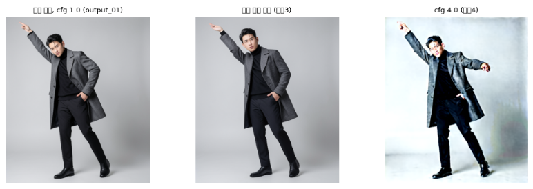
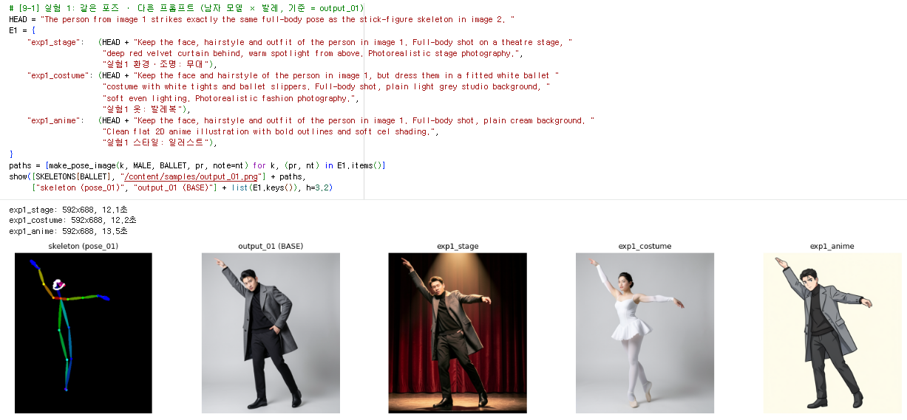

📅 2026-11-11 · AI 이해하고 사용하기 05

```
a factory worker
```

세 단어로 공장 사진을 시켰다.
작업자가 화면 한가운데서 카메라를 보고 서 있다. 못 쓸 건 아닌데 어정쩡하다.
다시 눌러도 비슷하다. 모델이 별로인가?
이날 수업의 첫 답은 "거의 언제나 아니다"였다.

> **3줄 요약**
> - 그림 한 장에는 **피사체·동작·카메라·조명·환경·스타일** 여섯 칸이 있다. 비워 둔 칸은 모델이 학습 데이터에서 가장 흔한 값으로 채운다.
> - **확산 모델**은 사진에 잡음을 뿌리는 과정을 거꾸로 배워, 잡음에서 그림을 꺼낸다. 문장을 좌표로 바꾸는 **텍스트 인코더**가 방향을 잡고, **가이던스**가 그 힘의 세기를 정한다.
> - 가중치가 공개됐다고 마음대로 써도 되는 건 아니다. 같은 이름의 모델도 크기에 따라 **라이선스**가 다르다.

## 같은 모델, 다른 그림: 프롬프트 여섯 칸

- **프롬프트**: 모델에게 건네는 주문서
- 그림 한 장이 성립하려면 정해야 하는 **여섯 칸**: 피사체, 동작, 카메라, 조명, 환경, 스타일
- 좋은 프롬프트는 길게 쓴 것이 아니라 **빈 칸이 없는 것**

사진작가는 셔터를 누르기 전에 누구를, 어떤 자세로, 어떤 렌즈로, 어떤 빛에서 찍을지 정한다.
정하지 않으면 사진이 안 찍힌다.
생성 모델은 다르다. 안 정해 주면 **알아서 정한다.** 그것도 학습 데이터에서 가장 흔했던 쪽으로.

교재는 모델과 시드(생성의 출발점이 되는 무작위 잡음을 정하는 숫자)를 고정하고 프롬프트만 바꿔 보였다.

| 단계 | 프롬프트에 적은 것 | 단어 수 | 결과 |
|---|---|---|---|
| 게으르게 | 공장 작업자 | 3 | 정중앙에 서서 카메라를 봄 |
| 피사체와 장소 | + 안전모, 점검 라인, 공장 안 | 16 | 안전모와 라인이 생겼지만 여전히 카메라를 봄 |
| 여섯 칸 다 | + 몸을 숙여 난간에 손, 50mm, 왼쪽 창의 아침 빛, 얕은 심도, 다큐 사진 | 67 | 적은 대로 나옴 |

가운데 그림에서 작업자가 카메라를 보는 건, **시선을 안 적었기 때문**이다.
모델은 한 번도 바뀌지 않았다.

나는 평소에 필요한 것만 적는다.
빈 칸을 알아서 채워 주는 것도 모델의 능력이니까.
그런데 맥락에 영 안 맞는 그림이 나올 때, 그리고 전에 만든 그림에서 **조금만** 바꾸려 했는데 전혀 다른 그림이 나올 때가 힘들다.
빈 칸은 맡겨도 되는 곳이지만, 그게 문제를 일으킬 때는 내가 채워야 하는 곳이었다.

## 노이즈에서 그림으로: 확산 모델의 계보

- **GAN**(적대적 생성 신경망): 위조범과 감정사를 함께 키운다
- **확산 모델**(diffusion model): 잡음을 뿌리는 과정을 거꾸로 배운다
- **CLIP**과 언어모델: 문장을 그림 쪽 좌표로 데려온다

그림 그리는 기계를 만들려면 먼저 "그럴듯함을 어떻게 채점하나"에 답해야 한다.
정답 사진과 픽셀 차이로 채점하면, 모델은 모든 고양이의 평균인 흐릿한 회색 덩어리를 그린다. 어느 사진과도 적당히 비슷하니까.

| 해 | 일어난 일 | 한 줄 |
|---|---|---|
| 2014 | GAN | 채점관(감정사)도 신경망으로 같이 키우자 |
| 2015 → 2020 | 확산 모델 | 우리가 뿌린 잡음을 맞히게 하자. 5년 묻혀 있다가 2020년에 꽃핌 |
| 2021 | CLIP | 문장과 그림을 같은 좌표 공간에 |
| 2022 | Imagen | 그림 공부보다 말귀. 언어모델을 키운 쪽이 이김 |
| 2022.8 | 잠재 확산 공개 | 압축한 공간에서 계산. 게이밍 노트북에서 돈다 |
| 2022 말~2024 | 트랜스포머 심장 | 잡음 예측 신경망이 U-Net에서 트랜스포머로. 글자가 덜 뭉개짐 |
| 2023 | 증류 | 50스텝을 4스텝으로. GAN이 조교로 복귀 |

### GAN: 위조범과 감정사

- 위조범(생성기)이 가짜를 만들고, 감정사(판별기)가 가려낸다. 겨룰수록 위조범 실력이 는다
- 감정사를 속이는 그림 하나를 찾으면 그것만 그린다. 숫자 0~9를 배웠는데 8만 내놓는 식 → **모드 붕괴**(mode collapse)
- 없는 얼굴은 잘 만들었지만, 문장으로 부탁한 장면("눈 덮인 산 위 빨간 오두막")은 약했다

처음엔 과적합이랑 같은 건가 싶었다.
과적합은 **외우는** 쪽, 모드 붕괴는 **다양성을 버리는** 쪽이었다.

얼굴만 그리는 화가는 있었지만, **주문서를 읽는 화가**는 아직 없었다.

### 확산: 문제를 바꾸다

- 깨끗한 사진에 잡음을 조금씩 뿌려 덮고, "방금 섞인 잡음이 뭐였나?"를 맞히게 한다
- 우리가 뿌린 잡음이니 정답을 안다. **채점관이 필요 없다**
- 생성할 땐 순수한 잡음에서 조금씩 걷어 낸다. 이 횟수가 실습의 **스텝 수**

### CLIP: 주문서를 읽는 화가

- 이미지와 캡션 4억 쌍으로 "어느 캡션이 어느 그림에 붙나"를 배웠다
- 문장과 그림이 **같은 좌표 공간**에 놓이니, 거리를 재서 프롬프트 쪽으로 밀 수 있다
- 지금은 그 자리에 현역 언어모델이 통째로 들어가 있다

04에서는 AI가 이미지를 **수치로 읽어 내는** 걸 배웠다.
05에서는 문장과 그림이 같은 좌표에서 만난다.
이제 진짜 AI에게 눈이 생기는구나 싶었다.

### 가이던스: 세게 밀면 좋아질까

- **가이던스**(CFG): 프롬프트를 준 예측과 안 준 예측의 차이를 키워, 프롬프트 쪽으로 미는 힘
- 올리면 프롬프트에 충실해지지만 **색이 타고 그림이 뻣뻣해진다**. 예측을 두 번 하니 계산도 두 배
- **증류 모델**은 권장값이 모델마다 다르다. SDXL-Turbo 0, FLUX.2-klein 4B 1.0, LCM-LoRA 1.0~2.0

과제에서 같은 조건으로 cfg만 1.0과 4.0으로 바꿔 봤다.



오른쪽 cfg 4.0은 대비가 지나치고 배경이 하얗게 날아갔다. 시간도 약 두 배(21.1초)였다.
크롬 브라우저에 있는 제미나이(Gemini)에게 물어보니 이렇게 정리해 줬다. (가끔 이상한 말도 하지만, 화면을 같이 보며 묻기에 편하다.)
- cfg를 올려도 "아무것도 안 바뀌는" 건 아니다. 프롬프트를 더 세게 따르려는 방향은 맞다
- 다만 증류 모델은 적은 스텝에 맞춰 이미 다듬어져 있어서, 세게 밀면 깔끔한 정답 대신 **과보정과 왜곡** 쪽으로 튄다

## 브라우저로 첫 장, 그리고 일부러 무너뜨리기

- 설치 없이 **Hugging Face Space** 데모로 시작한다
- **시드를 고정**하고 여섯 칸을 한 칸씩 채워 본다. 대개 카메라 칸에서 가장 크게 바뀐다
- 요소를 계속 더해 **어디서 무너지는지** 손으로 알아낸다

교안 실습은 FLUX.2-klein 4B 데모로 다섯 장을 뽑는 것이었다.
피사체만 → 환경 → 동작과 끝점 → 카메라 → 조명과 스타일 순으로 한 칸씩 더한다.
보는 건 그림이 예쁜지가 아니라, **적은 것이 들어왔는지**다.

한국어로 적어도 되긴 하지만, 학습 캡션이 영어에 치우쳐 있어 대체로 영어 쪽이 안정적이다.
나도 그래서 프롬프트를 일부러 영어로 만들어 생성하기도 한다.

무너지는 방식에는 패턴이 있다.
- 요청한 인물이 사라지거나 **하나 더 생긴다**
- 몸 없는 얼굴, **주인 없는 손**이 배경에 붙는다
- 화면 속 글자가 낙서가 된다

이때 "손가락은 다섯 개"처럼 더 길게 쓰면 오히려 나빠진다. 답은 **장면을 나누는 것**이다.

과제에서 나도 그 패턴을 만났다.
남자 모델에 댄스 포즈를 넣었더니 **다리가 세 개**였고, 작은 사람이 하나 더 생겼다.
포즈 사진의 배경 인물까지 뼈대로 잡힌 것이었다. ([첫 실행 이야기](https://github.com/eple-lab/flux-pose-controller/blob/main/docs/test/202611112103/README.md))

## 프롬프트를 쓰는 법

- **키워드 나열보다 문장**: 프롬프트를 읽는 게 언어모델이라서
- **부정형보다 긍정형**: "사람이 없는 공장"보다 "텅 빈 공장"
- **시드를 고정하고 한 번에 한 칸만** 고친다

`masterpiece, 8k, ultra detailed` 같은 키워드 나열은 그런 단어가 캡션에 붙던 시절의 습관이다.
지금은 그 자리에 "다큐멘터리 사진, 얕은 심도"처럼 **무엇을 찍은 사진인지** 적는 편이 통한다.

가장 인상적이었던 건 긍정형이다.
"사람이 없는 공장"이라고 적으면 사람이 나오기도 한다.
프롬프트는 결국 좌표가 되어 그림을 끌어당기는데, "사람이 없는"에는 **사람이라는 말이** 들어 있어서다.

사람도 하지 말라면 더 생각난다. "흰곰을 생각하지 마"라고 하면 흰곰이 떠오르는 **흰곰 효과**처럼.
그런데 AI도 똑같더라.
이건 꼭 기억해야겠다고 생각했다.

네거티브 프롬프트 칸에 수십 개씩 붙이는 `bad anatomy, bad hands...` 덩어리도 마찬가지로 조심해야 한다.
그 칸이 작동하는지는 모델과 실행 도구에 달렸고, 작동해도 효과가 증명된 적은 없다.
긍정형을 고치는 게 거의 항상 낫다.

잘 쓰는 사람과 못 쓰는 사람의 차이는 첫 프롬프트가 아니라 **고쳐 가는 방식**에 있다.
시드를 고정하고, 한 칸만 바꾸고, 무엇을 바꿨는지 적는다.

과제에서 시드 42로 고정하고 포즈는 그대로, 프롬프트만 바꿔 봤다.



무대(stage)와 일러스트(anime)는 인물이 그대로였다.
그런데 "얼굴과 머리는 그대로 두라"고 적고 **흰 발레복과 타이츠**를 입히자, 남자 모델이 여성 발레리나가 됐다.
내 해석으로는 "사람이 없는"이 사람을 끌어오는 것과 같은 구조다. "ballet costume, tights"라는 말이 그림을 발레리나 쪽 좌표로 끌어당겼다.

수업은 마지막에 **되물어 주는 도구**를 하나 준다.
여섯 칸 중 빈 칸만 골라 묻고, 60~120단어로 조립해 주는 에이전트 스킬이다.
퍼실님이 교재를 바탕으로 AI로 만들어 준 초안을, AI와 함께 이미지용과 영상용 스킬 두 개로 다듬어 다음 프로젝트를 위한 자산으로 쌓아 뒀다.

## 코드로 불러 자동화에 끼우기

- **API**: 코드가 부르라고 만들어 둔 입구. 프롬프트를 주소에 실어 보내면 그림이 돌아온다
- **Colab 무료 T4**에서 직접 돌리면 한 장에 1초 안팎. 그래야 고쳐 가며 반복할 수 있다
- 에이전트에게 맡길 땐 **입력 형식, 모델과 값, 재현 기록, 실패 처리**를 같이 준다

키 없는 공개 API는 세 줄이면 그림이 온다. 데모와 학습에는 훌륭하지만, 가동 보장이 없어 업무 자동화의 심장으로 쓰긴 어렵다.
Colab에서는 FLUX.2-klein 4B를 직접 내려받아 돌린다. 교안이 잰 값은 적재 94초, 첫 장 2.8초, 그다음 0.9초였다.

에이전트가 준 코드에서 확인할 곳은 넷이다.
- 서버를 한 번 띄워 재사용하는가
- 같은 id가 늘 같은 시드가 되는가
- 가이던스와 스텝이 지시대로 들어갔는가 (에이전트가 자기 기본값으로 되돌리기도 한다)
- 기록 파일에 시드까지 남았는가

나는 Colab 노트로 하늘을 나는 소를 한 번 뽑고, 설명을 따라가느라 바빴다.
들을 땐 알겠는데 돌아서면 기억이 잘 안 난다. 그래서 이렇게 적어 둔다.

## 무엇으로 만들까: 라이선스와 ControlNet

- **가중치 공개 ≠ 마음대로 사용**. 무엇에 걸린 제약인지(모델 사용인지, 만든 그림인지)를 본다
- 크기, 라이선스, 스텝 수는 **서로 독립**이다
- **ControlNet**: 윤곽선, 깊이, 사람 자세를 조건으로 넣어 구도를 잡는 보조 회로

| 모델 | 크기 | 라이선스 | 스텝 |
|---|---|---|---|
| FLUX.2-klein 4B (실습) | 40억 | 아파치 2.0 | 4 |
| FLUX.2-klein 9B | 90억 | **비상업** | 4 |
| SDXL-Turbo | 30억 | Stability 커뮤니티 (연매출 100만 달러 기준) | 1~4 |
| Z-Image-Turbo | 60억 | 아파치 2.0 | 8~9 |

같은 이름, 같은 회사, 같은 날 나온 모델인데 큰 쪽은 회사 일에 못 쓴다.
모델 페이지 위의 라이선스 배지를 먼저 보고, 아파치 2.0이나 MIT가 아니면 본문을 연다.

프롬프트로는 자세를 정확히 잡기 어렵다. 그래서 ControlNet이 있다.
사람 사진에서 관절(뼈대)을 뽑아 조건으로 주면, 인물과 배경은 프롬프트대로, 자세는 사진대로 그린다.
다만 FLUX.2에는 공식 ControlNet이 없다. 과제에서 나는 모델 안에 있는 **참조 이미지 여러 장 넣기**(multi-reference editing)로 대신했다. 무료 T4에 가장 가볍기 때문이다.

## 동영상도 만들 수 있을까

- **비는 칸이 중립이 아니다**: 카메라를 안 적으면 모델이 카메라를 움직인다
- 동작에는 **끝점**이 필요하다. "걸어와 문 앞에서 멈춘다"
- **소리도 칸**이다. 조용하길 원하면 조용하다고 적는다

영상은 여섯 칸의 연장이다. 카메라 칸에 움직임이 하나 붙는다(샷 크기, 움직임, 렌즈).
모델이 배운 영상 대부분은 카메라가 움직이는 영화 장면이라, 정하라고 맡기면 움직인다.

실무에서 더 자주 쓰는 방식은 **마음에 드는 그림 한 장에서 출발**하는 것이다.
이때 그림에 이미 보이는 건 다시 적지 않고, 움직임만 적는다. 다시 적으면 새로 그리라는 말로 읽는다.
나도 보통 그림부터 만들고, 그걸로 영상을 만든다.

한 번에 8~10초가 한계라, 1분짜리는 여덟 토막으로 나눠 만들고 앞 토막의 마지막 장면을 다음 토막의 출발 그림으로 쓴다.

## 과제: 원하는 포즈로 만들기

모델 사진(누구를)과 포즈 사진(어떤 자세로)을 넣으면, 모델 사진 속 인물이 그 자세를 취한 그림을 만드는 Colab 도구를 만들었다.

```
포즈 사진 ──DWPose──▶ 뼈대 이미지 ──┐
                                  ├─▶ FLUX.2-klein 4B (참조 2장 + 프롬프트) ─▶ 결과
모델 사진 ────────────────────────┘
```

발레 포즈는 튀튀에 가려 뒤로 든 다리가 뼈대에서 빠졌고, 결과도 두 다리로 서 있었다.
다시 만들지 않고 그대로 제출했다.
실패한 결과가 오히려 "**뼈대 품질 = 결과 품질**"을 가장 잘 보여 줬다.

- 저장소: [eple-lab/flux-pose-controller](https://github.com/eple-lab/flux-pose-controller)
- 튜토리얼 노트: [pose_tool.ipynb](https://github.com/eple-lab/flux-pose-controller/blob/main/pose_tool.ipynb)

## 회고: 돌아가는 톱니바퀴, 생성형 AI로 한 걸음

- 언어모델의 **트랜스포머**가 그림 모델의 심장이 됐다
- 언어모델이 **텍스트 인코더** 자리에 들어왔다
- 물러났던 **GAN**은 증류의 조교로 돌아왔다

트랜스포머가 나오고 나서, 여러 모달에서 비슷한 기술들이 함께 자라는 것 같았다.
톱니바퀴가 맞물려 돌아가는 느낌.

AI 발전이 사람들에게 위협이 되는 것도 맞다.
사람이 병목이 되어, AI가 하는 이야기를 이해하는 데 시간이 많이 들기도 한다.
그래도 혼자 사업하는 사람이 늘었다는 건, AI와 에이전트가 의미 있게 도움이 됐다는 뜻이라고 생각한다.

이젠 대화가 단순히 연산으로 나오는 게 아니라, 이해하고 있다고 느껴진다.
제약도 많지만, 여러 AI 에이전트와 일하다 보니 각각이 한 사람처럼 느껴질 정도다.

---

**아이펠 AI 에이전트 3기 AI 이해하고 사용하기 기록**
1. [AI이해-01 AI는 어떻게 배우나](/blog/aiffel/ai-use-01-learning-from-data-2026-11-05/)
2. [AI이해-02 트랜스포머와 토큰](/blog/aiffel/ai-use-02-transformer-tokens-2026-11-06/)
3. [AI이해-03 LLM과 로컬 실행](/blog/aiffel/ai-use-03-local-llm-2026-11-09/)
4. [AI이해-04 이미지 읽기](/blog/aiffel/ai-use-04-image-reading-2026-11-10/)
5. **AI이해-05 이미지 생성** ← 지금 글
