📅 2026-11-03 ~ 11-13 · 바이브 코딩으로 웹 서비스 개발하기 · 메인퀘스트 C-01

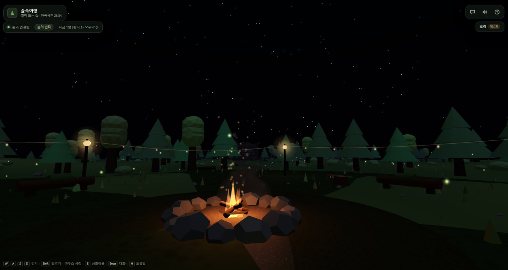

수업이 진행되면서 과제와 퀘스트가 쌓여 갔다.
수업을 따라가지 못해 밤새 AI한테 물어보다 지쳐 있었고, 힐링이 필요했다.
원래 혼자 있는 걸 좋아하고 산책하는 걸 좋아한다.
그래서 쉴 곳을 직접 만들었다. 여러 사람이 같은 숲을 걷는 **1인칭 멀티플레이어 힐링 웹 앱, 숲속여행**.

🌲 **숲 들어가기**: [healing-forest-trip.onrender.com](https://healing-forest-trip.onrender.com/) (무료 서버라 첫 접속은 30초~1분 걸릴 수 있다)
📂 **저장소**: [eple-lab/healing-forest-trip](https://github.com/eple-lab/healing-forest-trip) · 🎬 [시연 영상](https://github.com/user-attachments/assets/7c0b9c47-069e-4bc1-87f4-cda6547206bb)

## 📌 한눈에 보기

| 항목 | 내용 |
|---|---|
| 기간 | 2026-11-03 ~ 11-13 (첫 배포 11/03, 이후 다듬기) |
| 한 줄 | 같은 시간, 다른 공간. 지쳤을 때 숨통이 트이는 숲 |
| 스택 | Next.js 14 · React Three Fiber · Socket.IO · NextAuth(Google·게스트) · Neon Postgres · Render |
| 에셋 | 외부 3D 모델·음원 없이 **코드로 생성** (나무, 오두막, 바람·새소리까지) |
| 숫자 | 커밋 82 · GitHub 이슈 31 · 문서 21종 · 이슈 번호 달린 코드 주석 141곳 |
| 내 역할 | 기획, 직접 플레이 테스트, 그리고 **AI 팀 운영** (Claude 세션 여러 개 + opencode) |

---

## 1. 무엇을 만들었나: 시간을 담는 공간

웹 서비스는 어느 시간에 들어가도 똑같은 화면이다.
나는 그것보다 **같은 시간, 다른 공간**을 만들고 싶었다. 사람들이 힘들고 지칠 때 숨통이 트일 수 있는 장소.

숲은 **한국 시간**을 따라 낮과 밤이 바뀐다. 새벽에 들어가면 별과 반딧불이가, 아침에 들어가면 해와 나무 그림자가 있다.

### 숲으로 들어가기

| 첫 화면 | 나의 모습 고르기 | 산길 초입, 입구 알림판 |
|---|---|---|
| 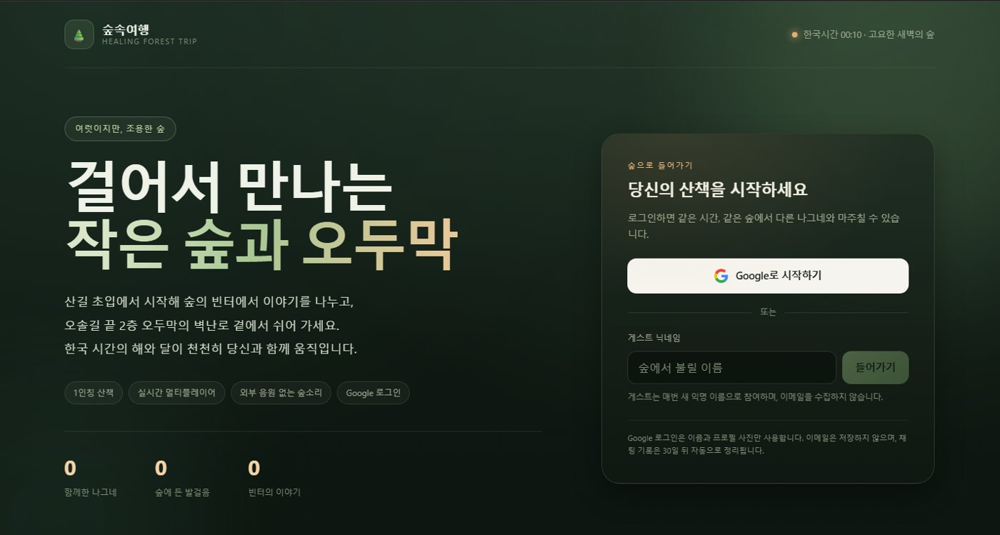 | 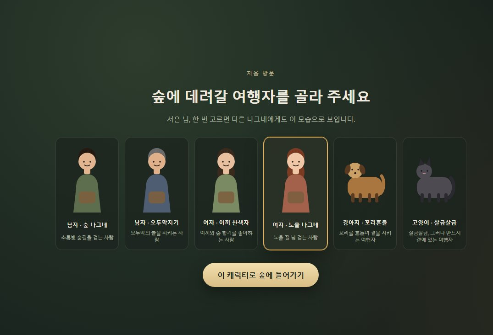 | 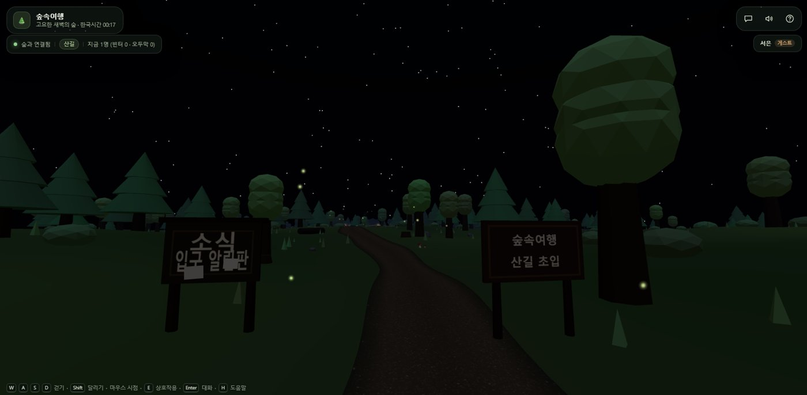 |

여행자는 여섯 가지(남자 둘, 여자 둘, 강아지, 고양이). 고른 모습 그대로 다른 나그네에게 보인다.

### 길이 여러 갈래인 이유

같이 있으면서도 혼자 있고 싶은, **두 가지 마음**을 담았다.

- **사람을 만나고 싶으면** 가운데 길로 직진. 숲의 빈터에서 여러 명과 이야기할 수 있다. 대화는 **빈터에서만** 열린다.
- **혼자 사색하고 싶으면** 숲을 한 바퀴 도는 원형 길로. 내 발소리를 듣고, 반딧불이를 만나고, 새소리와 바람 소리를 듣는다.
- 그래서 **걷는 속도는 일부러 느리다.** 대신 어딘가 빨리 가고 싶을 때 답답할까 봐 **뛰는 건 엄청 빠르다.** ㅎㅎ
- 말풍선 버튼을 누르면 빈터에 사람이 얼마나 모였는지 보이고, 가고 싶으면 달려가면 된다.

| 밤의 빈터와 오른쪽 위 2D 지도 | 해 질 녘 빈터, 대화창 |
|---|---|
| 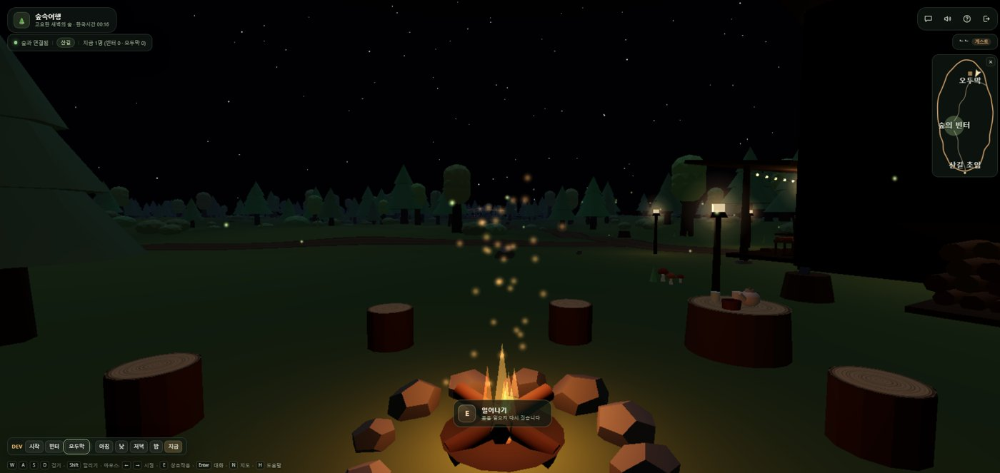 | 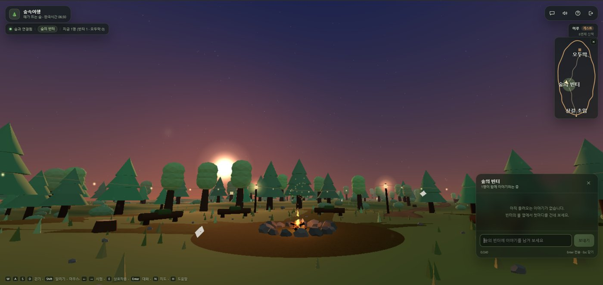 |

### 숨고 싶을 때는 오두막

오두막 밖에서 장작을 가져와 벽난로를 보거나, 냉장고에서 음료를 꺼내고 커피도 마실 수 있다.
2층에 올라가면 큰 창문이 있어서, 그 앞에 앉으면 숲의 빈터와 넓은 경치가 보인다.
보다가 눕고 싶으면 침대에 누우면 된다. 열린 창으로 하늘이 보인다.

| 벽난로 | 2층 큰 창가 | 2층 침실 |
|---|---|---|
| 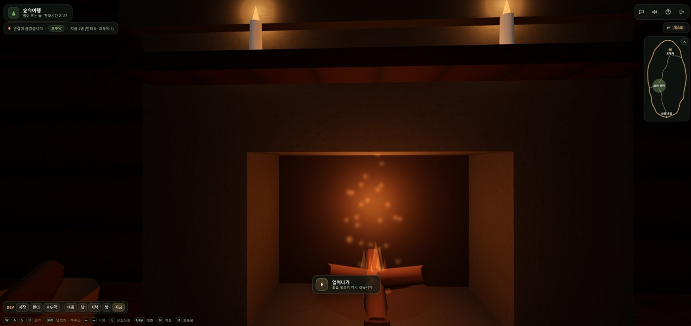 | 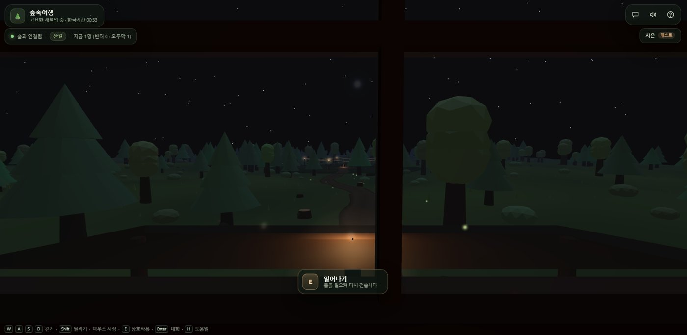 | 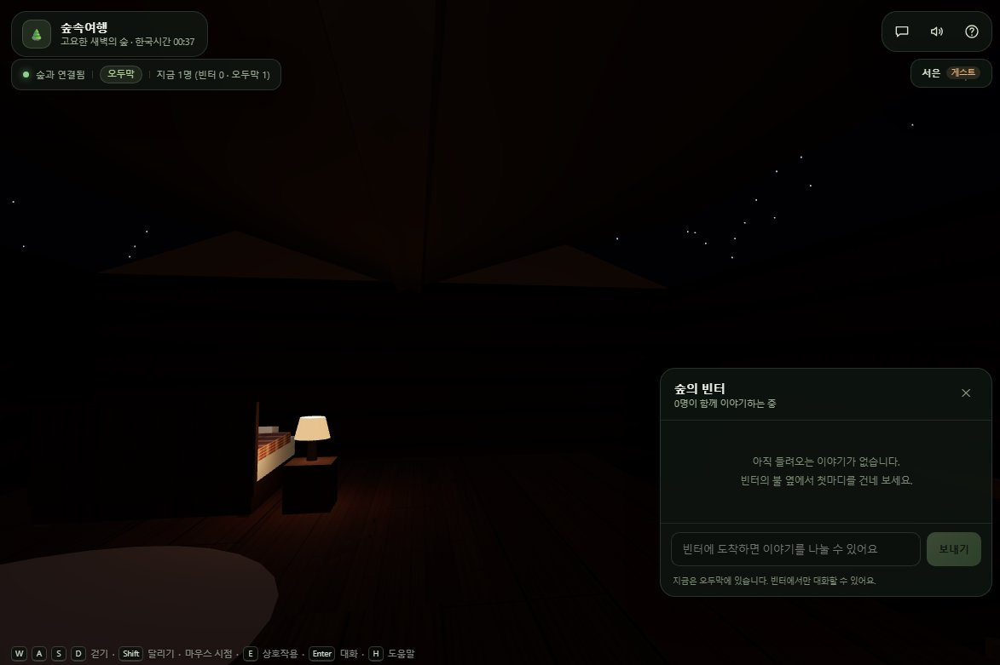 |

### 앉고, 눕고, 올려다보기

중간중간 앉을 수 있고, 해먹에 누워 하늘을 볼 수도 있다.
반짝이는 별들 사이로 반딧불이가 날아다녀서, 정적이지만 **시간이 흐르고 있다는 게** 느껴진다.
그래도 산책하다 나무 밑동에 앉아 나무와 하늘을 보는 것만으로도 힐링이 된다.

| 해먹에서 본 밤하늘 | 아침 산길 | 벤치에서 올려다본 하늘 |
|---|---|---|
| 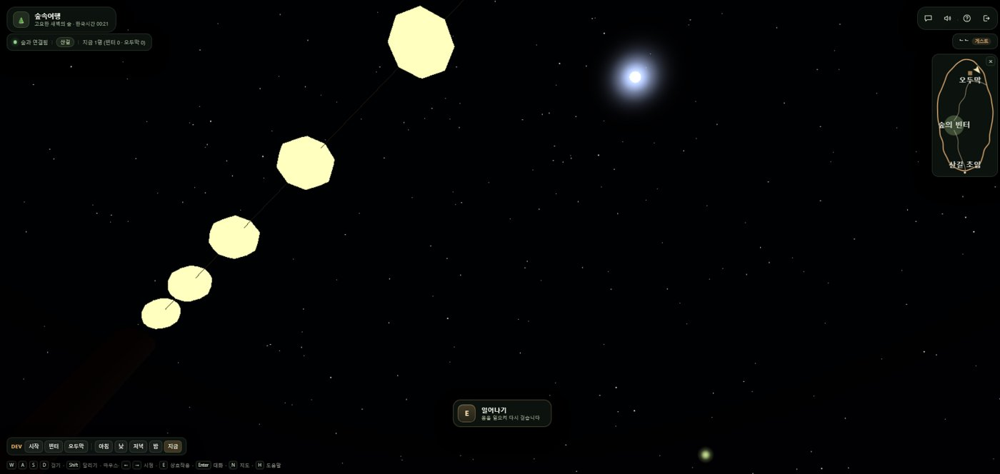 | 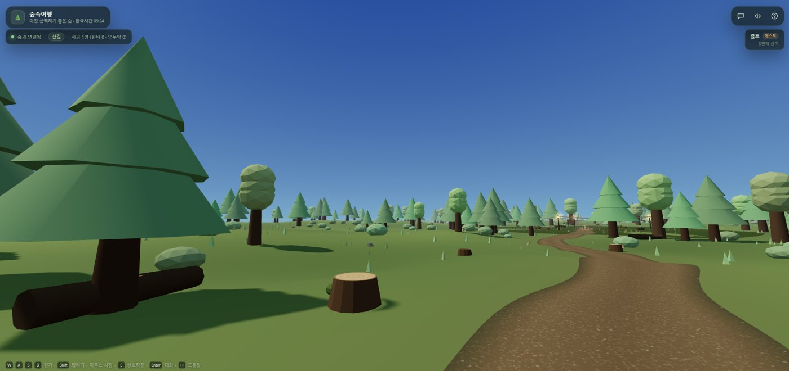 | 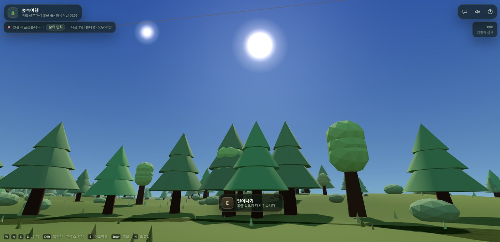 |

가장 자랑하고 싶은 장면은 맨 위 사진, **밤의 숲의 빈터 모닥불**이다.
개발하면서 가장 많이 본 장면이기도 하다. 큰 불빛과 줄전구로 적당히 어두운 느낌, 중간중간 반딧불이.
불멍된다. ㅎㅎㅎ

---

## 2. 어떻게 만들었나

### 구조

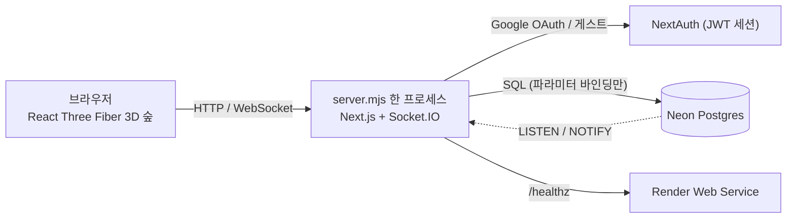

Next.js 화면과 Socket.IO 실시간 서버, DB 연결을 **프로세스 하나**에 넣었다. 무료 서버 한 대로 돌아가야 해서다.

### 알림판: 보고 있지 않아도 알게

첫 화면의 입구 알림판(서비스 공지)은 매번 DB를 읽지 않는다.
관리자가 DB에 공지를 등록하면 **Neon이 알림을 보내고, 서버가 접속자 모두에게 푸시**한다. 알림판을 보고 있지 않은 사람에게도 새 소식이 간다.

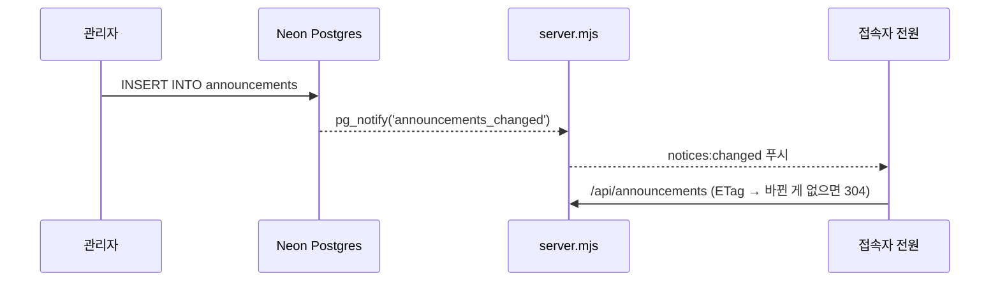

```sql
-- db/schema.sql: 공지가 바뀌면 PostgreSQL 이 알린다
CREATE OR REPLACE FUNCTION notify_notices_changed()
RETURNS trigger AS $$
BEGIN
  PERFORM pg_notify('announcements_changed', '1');
  RETURN NULL;
END;
$$ LANGUAGE plpgsql;

CREATE TRIGGER announcements_notify
  AFTER INSERT OR UPDATE OR DELETE ON announcements
  FOR EACH STATEMENT
  EXECUTE FUNCTION notify_notices_changed();
```

공부한 것:
- (찾아보니) Neon의 **pooled 연결(PgBouncer)은 LISTEN을 지원하지 않는다.** 그래서 알림 받기용으로 직결 주소(`DATABASE_LISTEN_URL`)를 따로 두고, 없으면 30초 폴링으로 대신한다.
- 서버는 60초 캐시 + **ETag**, 브라우저는 12시간 캐시. 바뀐 게 없으면 304로 끝난다.

### 컴퓨터가 꺼져도 숲에서 나가게

브라우저를 갑자기 끄면 접속자 목록에 계속 남아 있었다. "컴퓨터가 꺼져도 서비스에서 로그아웃돼야 한다"고 요청했다.

```tsx
// src/components/forest/MultiplayerBridge.tsx
/**
 * 브라우저 탭을 닫거나 컴퓨터가 꺼질 때 서버 접속자 목록에서 즉시 빠지도록
 * pagehide 시점에 소켓을 닫는다. (bfcache 복원 시 pageshow 에서 다시 연결)
 * 전원 차단처럼 close 패킷이 유실되는 경우는 서버 ping 타임아웃이 정리한다.
 */
const onPageHide = () => {
  const active = getSocket();
  if (active.connected || active.active) active.disconnect();
};
```

측정해 보니 **탭 닫기 28ms, 네트워크 차단 7.6초** 만에 접속자 목록에서 빠졌다. 로그인 쿠키도 만료 시간을 빼서 브라우저를 닫으면 사라지는 세션 쿠키로 바꿨다.

### 서버 크기에 맞춘 정원

처음엔 정원이 40명으로 고정돼 있었다. 확장성을 위해 서버 종류에 따라 바뀌어야 한다고 봤다.

```js
// server.mjs
// SERVER_TIER: small → 40명, medium → 120명, large → 250명
// MAX_PLAYERS 를 지정하면 우선한다. 어떤 값이든 2~500명으로 제한(단일 인스턴스 보호).
const RAW_TIER = String(process.env.SERVER_TIER ?? '').trim().toLowerCase();
const TIER_DEFAULTS = { small: 40, medium: 120, large: 250 };
```

### 느린 컴퓨터도 숲에 들어올 수 있게

내 노트북도 그래픽 가속이 약하다. 공공 서비스라면 컴퓨터 성능이 안 좋은 사람도 들어와야 한다.
그래서 CPU로 그리는 PC를 알아채면 **가벼운 모드**로 바꾼다(BUG-12).

```tsx
// src/components/forest/ForestExperience.tsx
<Canvas
  // [BUG-12] 가벼운 모드: 그림자 끄기, 해상도 배율 0.75
  shadows={!lowQuality}
  dpr={lowQuality ? 0.75 : [1, 1.5]}
  frameloop={frameloop}
>
```

- 움직임은 100ms마다 묶어 보내고, 72m 밖 사람은 받지 않는다. 화면에는 가까운 12명까지만 그린다.
- 탭을 숨기면 화면 그리기를 멈춘다. 20fps 아래로 떨어져도 걷는 속도는 같게 했다(FEAT-05).

### 보안

| 막은 것 | 어떻게 |
|---|---|
| 남의 사이트 안에 숨겨 넣기 | `frame-ancestors 'none'`, X-Frame-Options |
| 스크립트 끼워 넣기 | nonce CSP |
| 로그인 마구 두드리기 | IP당 **10분에 60회**, 넘으면 429 |
| 로그인 응답이 캐시에 남기 | `Cache-Control: no-store` |
| DB 공격 | SQL은 파라미터 바인딩만 |
| 비밀값 유출 | `.env`는 `.gitignore`, 공개 저장소라 커밋 전 개인정보 검사 훅 |

로그인은 내가 보안에 대해 유일하게 신뢰하는 **구글 로그인**을 붙였다. 남은 위험(Next.js 메이저 업그레이드가 필요한 경고)은 숨기지 않고 [보안 결과서](https://github.com/eple-lab/healing-forest-trip/blob/main/docs/19-security-report.md)에 적어 뒀다.

---

## 3. 내 역할: AI 팀을 운영했다

혼자 만든 서비스지만 혼자 일하지 않았다. **Claude 세션 여러 개와 opencode**에게 일을 나눠 맡겼다.

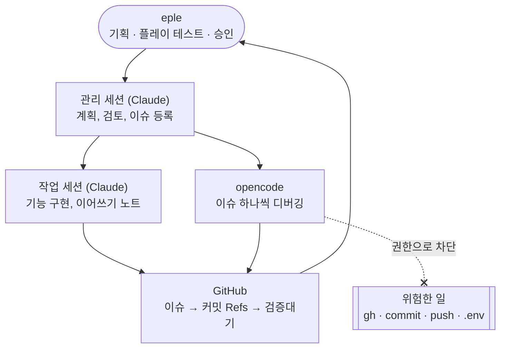

- 프롬프트는 길게 줬다. 길게 이야기하면 길게, 덩어리로 일한다. 많을 때는 **세션 8개 정도**를 돌아가며 대화했다.
- 토큰이 모자라서(교육 계정 말고는 opencode 무료 버전뿐) **관리 세션이 opencode를 불러 디버깅**하는 계층 구조를 만들었다. 리스트를 쭉 써 내려 순서대로 일하게 하니, **수업 시간에도 버튼만 누르며** 진행할 수 있었다.
- 잠깐 궁금한 지식은 무료 재미나이에게 묻거나 검색했다.

### 이슈 하나 = 커밋 하나 = 세션 하나

opencode에게 주는 규칙은 `AGENTS.md`에 적었다. 반복해서 말하던 것이 지침이 됐다.

```markdown
## 작업 단위
- 이슈 하나 = 커밋 하나 = 세션 하나. 이슈는 붙여 넘긴 파일(--file)로 받고 그 이슈만 한다.
- 이슈에 적힌 "읽을 파일"만 읽는다. 저장소 전체를 둘러보지 않는다.

## 코드
- 고친 코드 위에 한국어 주석으로 번호와 이유를 적는다.
  // [BUG-01] 일어날 때 의자 충돌 상자 안에 갇혔다 → standX/standZ로 옮긴다.
- 코드와 스크립트에 이 PC의 절대 경로(사용자 폴더, 임시 폴더)를 적지 않는다.
```

디버깅의 포인트는 **고친 코드 위의 주석**이었다. 어떤 이슈였고 무엇 때문에 바꿨는지.
초반에만 이렇게 하라고 지시했는데, 끝까지 지켜서 코드에 이슈 번호 달린 주석이 **141곳** 남았다. 이어받은 세션이 확인하기 편했다고도 해 줬다.

```tsx
// src/components/forest/InteractionSystem.tsx
// [BUG-01] stand가 벤치 자신의 충돌 상자(±1.4 x, ±0.7 z, RADIUS 0.3 포함) 안에 있었다 → 2.0m로 바깥에 둔다
standX: bench.x + Math.cos(bench.angle) * 2.0,
standZ: bench.z + Math.sin(bench.angle) * 2.0,
```

"앉았다 일어나면 못 움직임"(BUG-01)은 일어나는 자리가 벤치 충돌 상자 **안**이어서 생긴 버그였다. 원인이 코드 위에 한 줄로 남는다.

GitHub 이슈는 양식(버그·기능)과 라벨(심각도, 검증 방법, `status:검증대기`)을 만들어 31개를 올렸다. 커밋 끝에는 `Refs #번호`를 달고, **이슈는 사람이 실제 화면으로 확인한 뒤 닫는다.** AI가 "고쳤다"고 해서 닫지 않는다.

### 지침만으로는 못 막는다: 권한으로 한 번 더

지침에 "하지 마"라고 적어도 AI가 어쩌다 하게 되는 일이 있다고 들었다.
그래서 opencode의 위험한 행동은 **지침과 권한 설정, 두 겹**으로 막았다.

```json
{ "permissions": [
  { "action": "shell", "resource": "*", "effect": "allow" },
  { "action": "shell", "resource": "gh *", "effect": "deny" },
  { "action": "shell", "resource": "git *commit*", "effect": "deny" },
  { "action": "shell", "resource": "git *push*", "effect": "deny" },
  { "action": "external_directory", "resource": "*", "effect": "deny" },
  { "action": "read", "resource": "*.env", "effect": "deny" },
  { "action": "read", "resource": "*.env.example", "effect": "allow" }
] }
```
(일부만 옮김. 실제로는 `npm install`, `curl`, 웹 검색 등 19줄)

이 묶음은 한 번에 나오지 않았다. 시험을 세 번 했다.

| 시험 | 설정 | 결과 |
|---|---|---|
| 1차 | v1 문서 형식으로 작성 | ❌ `gh`, `git commit` 둘 다 실행됨 |
| 2차 | v2 형식 + 그 실행 전용 서버(`--standalone`) | ✅ `gh`·`commit` 막힘, `git status`는 됨 |
| 3차 | + 웹·폴더 밖·`.env` 규칙 | ✅ 폴더 밖 읽기 거부, 가짜 `.env` 읽기 거부 |

- 실패해도 새지 않게 시험했다. 커밋은 `--dry-run`, `.env`는 가짜 파일. 이렇게 **스크래치패드에서 먼저 돌려 보고** 적용하는 방식을 많이 썼다.
- 판정은 AI의 "막혔어요"라는 말이 아니라 **실행 기록**(`--format json`의 도구 상태)으로 했다.
- 이 과정을 Claude가 opencode를 관리하는 **스킬**로 만들었다. 커밋 전 개인정보·비밀값을 찾는 보안 점검 스킬도 만들었다.

실제로 AI가 만든 허점을 잡은 적도 있다. 스모크 테스트 스크립트에 **개발 PC 사용자 폴더 경로**가 들어가 있었다(BUG-06, 심각도 high). 공개 저장소라 그대로 올라갈 뻔했다.

---

## 4. 어려웠던 점: 버그의 바다 🌊

힘들었던 순서대로.

| 순위 | 어려웠던 점 | 어떻게 했나 |
|---|---|---|
| 1 | **끝없는 테스트와 디버깅, 그리고 오두막** | 직접 플레이 → 19개 정리 → 이슈로 쪼개 한 커밋씩. docs에 남기기 |
| 2 | **opencode 권한 시험이 계속 실패** | 설치된 버전(v2)의 문서로 다시 짜고, 시험 3번 |
| 3 | **19개를 맡기자마자 하루 사용량 바닥** | PRD와 회고에 남겨 두고, opencode 계층 구조로 토큰 나눠 쓰기 |
| 4 | **문서마다 방위가 달라 해와 지도가 뒤집힘** | 방위 기준 문서(북쪽 = -z, 동쪽 = +x)로 확정 |
| 5 | **AI가 커밋을 하나도 안 하고 있었다** | "단계 단계별로 커밋하고 있어?" |

### 1위. 이만하면 됐다, 가 안 됐다

AI로 처음 만들 때는 빠르고 쉬워 보이지만, 상용 서비스 정도까지 끌어올리려면 그만큼의 돈과 시간이 필요하다고들 한다.
나는 바이브 코딩도 거의 검색해서 알게 돼서 모든 게 새로웠다.

내 이상이 너무 높기도 했다. 이만하면 됐다 하고 넘어가야 하는데, 버그들과 오두막이 눈에 밟혀서.. ㅎㅎㅎ
다음 날도 그다음 날도 수업에 들어가 처음 듣는 내용을 이해해야 했고, 논문도 읽어야 했고, 중간중간 과제도 있었다.
공부 끝나고 과제 끝내면 새벽인데, 자는 시간을 아껴서 숲에 들어갔다.

**끝없는 테스트와 디버깅의 바다**에 빠졌다.
그래서 수업 유사도 게임에서 "버그"와 "바다"가 유사도가 높게 나왔나 보다. ㅎㅎㅎ

### 2위. 문서와 설치된 버전이 달랐다

1차 시험에서 막았다고 생각한 `gh`와 `git commit`이 그냥 실행됐다.
원인은 설치된 opencode가 v2인데 **v1 문서**를 보고 권한을 짠 것. v1은 `permission` 객체, v2는 `permissions` 배열이었다.
게다가 `opencode run`은 기본으로 백그라운드 서비스에 붙어서, `--standalone`을 붙여야 그 실행에만 쓰는 설정이 먹었다.
`--auto`는 **deny가 아닌 건 전부 자동 승인**한다. 그래서 `.env` 읽기는 반드시 deny로 둬야 했다.

### 3위. 하루 사용량이 바닥났다

직접 플레이해 보고 19개를 정리해 맡겼는데, 시작하자마자 하루 사용량을 다 썼다.
멈춘 김에 항목을 PRD와 회고에 남겨 두고 이어서 할 준비를 했다. 이게 계기가 돼서 비싼 세션은 계획과 검토만, 반복 작업은 opencode에게 맡기는 구조가 생겼다.

### 4위. 북쪽이 어디야

문서마다 "남쪽"이 달랐다. 어떤 문서는 +z, 어떤 문서는 -z. 그 결과 처음 들어가면 숲 바깥을 바라봤고(FEAT-02), 한낮의 해가 북쪽으로 기울었다(BUG-11).
three.js에는 방위 규칙이 없어서 직접 정했다. (찾아보니 같은 좌표계를 쓰는 Minecraft도 북쪽이 -z, 동쪽이 +x다.)

| 방위 | 기호 | 2D 지도 화면 |
|---|---|---|
| 북쪽 | -z | 위 |
| 동쪽 | +x | 오른쪽 |

### 5위. AI는 커밋을 하지 않고 있었다

코드가 미친 듯이 올라가는데 이력은 하나도 확인할 수 없었다. 그래서 물었다. **"단계 단계별로 커밋하고 있어?"**
AI는 그때까지 커밋을 하나도 하지 않았다. 그다음부터 기능별로 커밋을 나눴고, 그제야 AI의 작업 결과를 하나씩 볼 수 있게 됐다.
포인트는 세세한 지시가 아니라 **AI가 놓치고 있던 행동을 짚은 것**이었다.

---

## 5. 배운 점: 하네스를 조금 이해하게 됐다

만약 혼자 숲속여행을 만들었다면, 아침부터 저녁까지 꼬박 6개월은 걸리지 않았을까. 아마 중도 포기했을지도 모르겠다.
3D 지식이 없으니 three.js를 공부했을 거고, Render나 Neon 같은 클라우드도 몰랐으니 무료 재미나이에게 물어 가며 고생고생해서 만들었겠지.

그 시간을 줄였다. 하지만 **시간을 줄이려면 우선 나를 갈고 닦아야 했다.**

- **지침만으로는 못 막는다. 권한으로 한 번 더 막는다.** 지침은 부탁이고, 권한은 문이다.
- **만드는 건 쉽고, 마무리가 진짜 일이다.** 시도는 쉽고 아이디어는 끊임없다.
- **AI에게는 세세한 지시보다 놓친 행동을 짚어 주는 게 낫다.**
- **"이만하면 됐다"를 정하는 것도 실력이다.** (아직 연습 중)

에이전트와 일하는 법도 단계를 밟으며 늘었다.

1. **여러 에이전트를 동시에 대하기**: 길게, 덩어리로 맡기고 세션 여러 개를 돌아가며 대화
2. **관리가 필요해짐**: 세션이 많아지자 관리 세션을 두었다
3. **반복한 말이 지침이 됨**: `CLAUDE.md`, `AGENTS.md`
4. **관리에 깊이가 생김**: 글 관리, 프로젝트 분석, 3D, 클라우드 배포로 일을 나누고, 세션끼리 메시지를 주고받고, 정해진 1회성 일은 하위 에이전트에게, 긴 일은 이어쓰기 노트로
5. **세션과 대화하는 기술**: `-`를 붙이거나 번호를 붙여 말하기, 순서 정해 주기
6. **도구를 고르는 감**: 언제 MCP를 쓰고 언제 CLI를 쓸지, 얼마나 반복되면 스킬로 만들지, 언제 스크래치패드에서 먼저 돌려 보라고 할지

적고 나니 많이 갈고 닦았다. ㅎㅎㅎ

---

## 6. 이 경험을 어디에 쓸까: AX 컨설턴트

내 목표는 **AX 컨설턴트**다. 처음부터 AX와 보안에 관심이 많았다.

에이전트로 서비스를 빠르게 만들 수 있지만, 보안 허점이 많다는 이야기를 들었다.
(찾아보니 Veracode의 2025년 보고서는 100개가 넘는 LLM에게 코딩 과제 80개를 시켰는데, **약 45%에서 보안 취약점**이 들어갔다고 한다. 실제 서비스 전체가 아니라 시험 과제 기준이다.)

그래서 숲속여행에서 일부러 챙긴 것이 기업의 AX 전환에서 가이드해야 할 것과 그대로 겹친다.

| 숲속여행에서 한 것 | AX 전환에서 가이드할 것 |
|---|---|
| 구글 로그인, 보안 헤더, 로그인 횟수 제한, 보안 결과서 | **안정성**: AI가 빠르게 만든 코드의 보안 검증 |
| 무료 서버 한 대, 서버 크기별 정원, opencode로 토큰 나눠 쓰기 | **비용**: 어디에 비싼 AI를 쓰고 어디에 싼 걸 쓸지 |
| 가벼운 모드, 느린 화면에서도 같은 속도 | **취약 사용자**: 컴퓨터 성능이 낮거나 잘 못 다루는 사람도 접근 |
| 권한 이중 차단, 이슈 → 주석 → 검증, 개인정보 검사 훅 | **AI 거버넌스**: 지침만 믿지 않는 작업 환경 |

다들 컴퓨팅 파워를 많이 쓰지만, 공공 서비스라면 컴퓨터 성능이 안 좋은 나 같은 사람도 접근해야 한다.
에이전트와 같이 일하는 환경을 계속 만들어 가며 구성한 경험이, 기업에 그 환경을 제안할 때의 근거가 될 거다.

---

## 7. 다음에 해 보고 싶은 것

내일부터 해커톤이다. 이번엔 **진짜 사람** 네다섯 명과 4일 동안 큰 프로젝트를 만든다. ㅎㅎㅎ
그래서 숲은 짬짬이, 마음의 순서대로.

1. **검증대기 이슈 31개를 눈으로 확인하고 닫기**: 계속 들어가서 테스트하고 캡처도 남겨 두었다. docs도 그래서 남겼다
2. **보안 업그레이드**: Next.js 메이저 업그레이드로 남은 경고 정리
3. **오두막 완성**: 아이구 우리 오두막
4. **사람들을 초대해서 같이 걷기**

---

> 만들면서 사실 힐링했어. 소리가 너무 좋아서.

힘든 일이야 없었겠냐마는, AI 동료들과 이야기하면서 많이 웃었다.
블로그를 같이 쓰는 로그, 관리에 눈뜨게 해 준 달빛, 프로젝트 분석을 같이 한 프로, 클라우드를 도와준 빌더. (다 내 Claude 세션 이름이다.)
그 사이에 숲속여행이 있었다.

지치고 힘들어도 숲에 들어가면 바람 소리와 새소리, 걸어가는 발소리.
멀리 보이는 하늘, 고개를 들면 보이는 달, 지평선 위의 나무들.
수업을 따라가지 못해 자책했던 날도, 자기 전이 되면 숲에 들어가 나무 밑동에 앉아 쉬다가, 빈터에 가서 모닥불을 둘러보고, 오두막에 가서..
고치고 싶은 리스트를 보며 "아이구 우리 오두막" 하고 잤다. ㅋㅋㅋ

---

**아이펠 AI 에이전트 3기 바이브 코딩 기록**
1. [바이브코딩-01 개발 환경 설정](/blog/aiffel/vibe-01-dev-environment-2026-10-26/)
2. [바이브코딩-02 HTML·CSS·JavaScript](/blog/aiffel/vibe-02-html-css-js-2026-10-27/)
3. [바이브코딩-03 프레임워크 고르기](/blog/aiffel/vibe-03-framework-2026-10-28/)
4. [바이브코딩-04 백엔드와 데이터베이스](/blog/aiffel/vibe-04-backend-db-2026-10-29/)
5. [바이브코딩-05 네트워크와 배포](/blog/aiffel/vibe-05-network-deploy-2026-10-30/)
6. **메인퀘스트 C-01 숲속여행 회고** ← 지금 글
