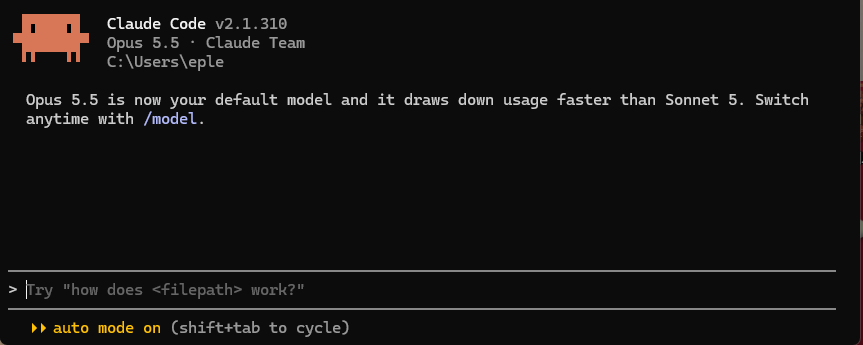
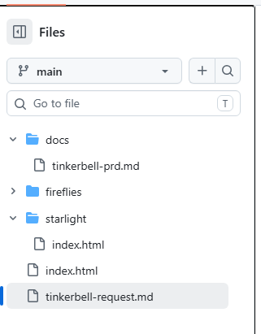

OT 모듈이 끝났다. 한 문장으로 정리하면 이거.

**"정신없는 기본 지식과 설치."**

다섯 레슨 동안 도구를 깔고, 규칙을 익히고, 퀘스트를 깨고, 내 분야를 쪼개 봤다.
"OT에서는 뭘 해?"가 궁금한 분들을 위해 한 번에 볼 수 있게 묶었다.

## OT 5개 레슨 한눈에 보기

| # | 레슨 | 한 줄 정리 |
|---|---|---|
| 1 | [협업 툴 소개](/blog/aiffel/ot-01-collaboration-tools-2026-10-21/) | Zep에서 듣고, 노션에 정리하고, 디스코드에서 떠든다 |
| 2 | [아이펠이란?](/blog/aiffel/ot-02-what-is-aiffel-2026-10-21/) | 강사 대신 퍼실, 혼자 대신 커뮤니티. 출결 규정은 엄격 |
| 3 | [퀘스트란?](/blog/aiffel/ot-03-quest-2026-10-21/) | 던전, 퍼실 몹, 선생팀과 학생팀. 가르치는 쪽이 제일 많이 배운다 |
| 4 | [코딩 0줄로 여는 첫날](/blog/aiffel/ot-04-coding-zero-day-2026-10-22/) | "늦은 거 아냐?"에 대한 답: 도메인 경험은 출발점 |
| 5 | [Computational Thinking](/blog/aiffel/ot-05-computational-thinking-2026-10-23/) | 일을 네 동작으로 쪼개야 AI가 제대로 일한다 |

## 좋았던 것 (Keep)

- **질문하기 쉬운 분위기.** 채팅으로 바로 묻고, 퍼실님과 동기들이 같이 답해 준다. "일단 던져봐요"는 진짜 문화였다.
- **역할별로 나뉜 도구.** 듣는 곳, 정리하는 곳, 떠드는 곳이 달라서 온라인인데도 대화가 많았다.
- **배운 걸 바로 만들어 본 경험.** 컴퓨팅 사고 과제를 실제 에이전트([news-pick](/docs/news-pick/))로 만들어 보니 개념이 손에 남았다.

## 아쉬웠던 것 (Problem)

- **퀘스트에서 AI와 더 연결 짓지 못한 것.** git을 주로 명령어 위주로 가르쳤는데, "AI와 어떻게"까지 더 이야기했다면 좋았을 거다.
- **설치에 든 시간.** Node.js, uv가 예전 버전과 겹쳐서 한참 헤맸다. 이 삽질은 [개발환경 세팅 글](/blog/learning-log/dev-environment-setup-2026-10-27/)에 따로 정리했다.
- **느린 노션.** 이건 내 힘으로 어쩔 수 없다 ㅡ,.ㅡ;;

## 다음에 해 볼 것 (Try)

- 선생팀이 되면 "**이게 AI랑 무슨 관계가 있을까?**"부터 설명하기
- 매일 배운 걸 **러닝로그**로 짧게라도 남기기
- 도메인 로드맵의 성장 카드를 **해커톤 전에 한 번 더 다듬기**

## 솔직히, 앞으로가 더 걱정이다

OT는 내용이 가벼운 편인데도 **하루 종일이라 분량이 많았다.**
앞으로는 내용이 어려워지고 분량은 그대로거나 더 늘겠지...
다음 모듈부터 HTML·CSS·JavaScript, 프레임워크, 백엔드, 데이터베이스, MCP 같은 에이전트 도구가 기다리고 있다.

그래도 OT에서 얻은 게 하나 있다.
막히는 건 이상한 일이 아니라는 것.
모르면 던지고, 같이 풀고, 기록하면 된다. 일주일 동안 그걸 연습했다.

## 아이펠을 고민하는 분께

- OT는 **코딩보다 "어떻게 배울지"를 맞추는 주**다. 코딩을 몰라도 시작할 수 있다.
- **카메라와 마이크를 켤 수 있는 환경**은 꼭 준비하기.
- **Node.js, Git 같은 도구를 미리 한 번 깔아 보면** 첫 주가 훨씬 덜 정신없다.

---

**아이펠 AI 에이전트 3기 OT 기록**
1. [OT-01 협업 툴](/blog/aiffel/ot-01-collaboration-tools-2026-10-21/)
2. [OT-02 아이펠이란](/blog/aiffel/ot-02-what-is-aiffel-2026-10-21/)
3. [OT-03 퀘스트 후기](/blog/aiffel/ot-03-quest-2026-10-21/)
4. [OT-04 코딩 0줄로 여는 첫날](/blog/aiffel/ot-04-coding-zero-day-2026-10-22/)
5. [OT-05 컴퓨팅 사고](/blog/aiffel/ot-05-computational-thinking-2026-10-23/)
6. **OT 회고** ← 지금 글
