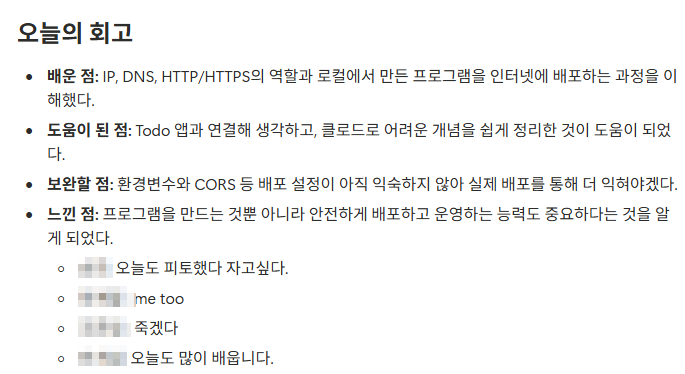

나: 이거 봐! 내가 만든 Todo 앱이야. `http://localhost:3000`
친구: 안 열리는데?

다섯 번째 날은 이 장면에서 시작했다.
친구의 localhost는 **친구 컴퓨터**를 가리키니까 당연히 안 열린다.
혹은 친구의 컴퓨터에서 돌고있는 `http://localhost:3000`이 열린다 ㅋ

> **3줄 요약**
> - 배포는 내 컴퓨터에서 돌던 서비스를 **다른 사람도 접속할 수 있는 주소**에서 실행하는 일.
> - 안 열리면 **주소·도달성 → 요청·응답(상태 코드) → HTTPS** 순서로 어디서 멈췄는지 본다.
> - AI는 "돌아가는 코드"는 잘 만들지만 "안전한 코드"는 **요구해야** 챙긴다.

## 주소가 화면이 되기까지

| 묶음 | 확인할 것 |
|---|---|
| ① 주소와 도달성 | 도메인·DNS, localhost·사설 IP·NAT, 포트·방화벽 |
| ② 요청과 응답 | HTTP, 상태 코드 (2xx 성공, 4xx 요청 쪽, 5xx 서버 쪽) |
| ③ 안전한 통신 | HTTPS와 인증서 |

401과 403의 차이.
- **401** "누구세요?" - 로그인 안 함
- **403** "누군지 알지만, 넌 안 돼" - 권한 없음

OAuth2 서버 만들면서 401, 403을 죽어라 다뤘는데 ㅋ 오래되니 기억이 가물가물하다 ㅎ

## AI 코드의 약점

보안 회사 조사로는 AI가 만든 코드의 약 45%에 보안 결함이 있었다고.
아직 AI가 모든걸 잘하는건 아니다. 그리고 AI가 학습한 코드 대부분은 사람이 짠거다 ㅋ

- 사용자 입력은 **서버에서 다시 검증**
- 비밀값은 코드 말고 **환경변수**로 (`.env`는 깃에 안 올리기)
- 로그인(인증) 뒤에 **권한**(인가)까지 확인, 비밀번호는 **해시**로

공개 GitHub에 유출된 비밀키가 1년에 2,865만 개라는 이야기,
무료 호스팅이 하나둘 사라지는 이야기도 나왔다.
무료 호스팅은... 수요가 많으니까 무료로 꼬시고 유료로 바꾸는 뻔한 패턴.

**시큐어 코딩은 생활이지 ㅋ**

## 실습: Todo 앱 공개

공개는 했다. ㅋㅋㅋ
그런데 04에서 길 B(Supabase)를 아직 push하지 않아서, **길 A까지만** 데모 버전으로 GitHub Pages에 올라가 있다.
도메인은 살 생각이 없어서 따로 연결하지 않았다.
데모가 돌아가게 올려놨다.

## 이번 주 회고 - 우리 팀

이번 주 마지막 날, 팀이 함께 쓴 회고. (이름은 가림 ㅎ)

배운 점, 도움이 된 점, 보완할 점, 느낀 점.
그리고 마지막 네 줄이 이번 주를 제일 잘 요약한다.
"오늘도 피토했다 자고싶다", "me too", "죽겠다", "오늘도 많이 배웁니다."

개발 환경부터 배포까지 5일.
이번 주가 끝나고, 이번 달도 끝났다.
커리큘럼 일정을 보니 다음달이 무섭다.
앞으로 더 어려운게 무궁무진 할건데..
근데 이제부터가 배우고 싶던 진짜다 라고 생각하니 가슴이 두근두근하다. ㅎ

---

**아이펠 AI 에이전트 3기 바이브 코딩 기록**
1. [바이브코딩-01 개발 환경 설정](/blog/aiffel/vibe-01-dev-environment-2026-10-26/)
2. [바이브코딩-02 HTML·CSS·JavaScript](/blog/aiffel/vibe-02-html-css-js-2026-10-27/)
3. [바이브코딩-03 프레임워크 고르기](/blog/aiffel/vibe-03-framework-2026-10-28/)
4. [바이브코딩-04 백엔드와 데이터베이스](/blog/aiffel/vibe-04-backend-db-2026-10-29/)
5. **바이브코딩-05 네트워크와 배포** ← 지금 글
