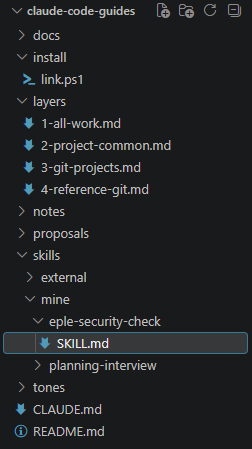

"AI 에이전트 도구 - 내 AI를 더 강하게 (MCP·스킬·하네스)" 과제로, 
제가 실제로 쓰고 있는 스킬 `eple-security-check`를 제출했습니다. 
과제를 위해 새로 만든 스킬이 아니라, 주말 동안 실수를 겪으며 만들고 고쳐 온 스킬입니다.

보안 점검 스킬이라 스킬 파일은 블로그에 싣지 않고, 만든 이야기만 적습니다. 
과제 저장소는 비공개로 두고 퍼실님께만 공유했습니다.

<!--more-->

## 과제

| 항목 | 내용 |
|---|---|
| 무엇을 | 매번 AI에게 반복해서 시키던 일을 스킬 하나로 만들기 |
| 무엇으로 | SKILL.md(이름·설명·절차) + 왜 만들었는지 적은 README |
| 인정 | description만 봐도 언제 쓰는지 알고, README에 불편 → 해결이 있고, 다른 대화에서 한마디로 발동된다 |

## 스킬이 사는 곳: 가이드 저장소

"스킬 하나를 왜 저장소까지 만들어 관리하지?" 싶을 수 있습니다. 
스킬은 이 저장소의 일부입니다. 
저는 Claude Code 세션 여러 개에 역할을 나눠(블로그, 3D·보안, 프로젝트 …) 일을 맡기고 있고, 
가이드 저장소는 그 세션들이 **함께 따르는 규칙과 도구를 git으로 관리하는 곳**입니다.

| 폴더 | 하는 일 |
|---|---|
| `layers/` | 규칙 파일 (1 모든 작업 공통, 2 프로젝트 공통, 3 git 프로젝트, 4 참고용 git) |
| `skills/` | 스킬 (내가 만든 것과 외부에서 가져온 것) |
| `install/` | 스킬을 모든 세션에서 쓰도록 연결하는 스크립트 |
| `proposals/` | 세션들이 보내는 변경 제안 |
| `notes/` | 세션 역할표와 이어받기 노트 |
| `tones/` | 블로그 글 말투 |

수업에서 배운 것과 겹쳐 보면 이렇습니다.

| 수업에서 배운 것 | 가이드 저장소에서는 |
|---|---|
| 규칙 파일 (AGENTS.md·CLAUDE.md) | 폴더마다 있는 `CLAUDE.md`가 레이어를 불러옵니다. 어느 폴더에서 세션을 열든 그 자리에 맞는 레이어가 자동으로 적용됩니다. 각 `CLAUDE.md`에는 "여기 말고 가이드 저장소의 레이어를 고치라"는 주석과 불러오기 한 줄만 있어서, 규칙은 한곳에서만 고칩니다 |
| 스킬 | 가이드 저장소에 두고 연결 스크립트로 이으면, 모든 세션의 스킬 목록에 나타납니다 |
| 컨텍스트 부패 | 긴 대화 대신 노트와 규칙 파일에 상태를 남기고, 큰 단계가 끝나면 이어받기 노트를 씁니다 |
| 컴파운드 엔지니어링 | 세션이 일하다 배운 점은 레이어나 스킬을 직접 고치지 않고 `proposals/`에 제안합니다. 관리 세션이 검토하고, 제가 확인하면 반영합니다 |

정리하면, 규칙이 자동으로 적용되고 
세션들이 제안까지 하며 스스로 자라는 **작은 관리 체계**입니다. 
이번에 낸 스킬도 블로그 세션이 낸 제안("커밋 전 개인정보 점검을 추가해 달라")이 반영되면서 지금 모양이 되었습니다.

## 왜 만들었나 (불편 → 해결)

### 불편: 한 번 올라가면 지울 수 없다
- Todo 앱 과제를 하면서, 문서에 **테스트 계정 이메일**이 적힌 채 커밋·push됐습니다. 
지금 파일은 "계정 A·B"로 바꿨지만, GitHub의 지난 버전에는 남아 있습니다.
- 블로그에서도 **개인 폴더 경로**가 들어간 글을 올렸다가 뺀 적이 있습니다. 
파일은 고쳐도 변경 이력에는 남습니다.
- 원인은 단순했습니다. 
이 노트북은 프로젝트 전용이라 사용자 이름과 계정 이름이 같습니다. 
그래서 경로나 이름이 적혀 있어도 눈에 잘 띄지 않았습니다.
- 그때마다 AI에게 "커밋 전에 이메일이랑 경로 있는지 봐 줘"를 다시 설명하고 있었습니다.

### 해결: 커밋할 때마다 같은 순서로 막는다
- 커밋하기 전에, 올릴 내용에서 이메일·개인 폴더 경로·토큰 모양을 **눈이 아니라 검색으로** 찾습니다.
- 글과 문서에는 대체 표현을 씁니다. 이메일은 "계정 A·B", 경로는 `~`처럼요.
- 캡처 이미지는 글자 검색으로 못 찾으니, 주소창·로그인 이메일·터미널 경로를 눈으로 확인하고 가립니다.
- 이미 올라갔다면, 실제 값인지 테스트 값인지에 따라 대처를 나눕니다.

그 밖에 비밀값, 입력 검사, 권한, AI 에이전트가 외부 내용을 읽을 때의 방어까지 점검표로 묶었고, 
결과는 항목마다 "통과 / 문제 있음 / 확인 못 함"으로 보고하게 했습니다.

## 이름에 eple이 붙은 이유

처음에는 `security-review`라고 지었습니다. 
그런데 Claude Code에는 같은 이름의 기본 명령(`/security-review`, 바뀐 코드를 보안 리뷰)이 이미 있었습니다. 이름이 겹치면 어느 쪽이 실행될지 헷갈릴 수 있어서 `eple-security-check`로 바꿨습니다.

역할도 다릅니다. 
기본 명령은 넓은 범위의 보안 리뷰이고, 이 스킬은 **제 프로젝트에서 실제로 겪은 실수**를 다시 하지 않기 위한 점검표입니다.

## 실제로 써 본 기록

| 날짜 | 어디서 | 무엇을 | 결과 |
|---|---|---|---|
| 2026-11-01 | Todo 앱 저장소 | 버그 수정 + 문서 7개 + 캡처 6장 커밋 전 | 검색에 걸린 줄 없음. 캡처 속 로그인 이메일은 "계정 A·B"로 가린 뒤 커밋 |
| 2026-11-02 | 가이드 저장소 | 제안서 커밋 전 | 검색에 걸린 줄 없음 |
| 2026-11-02 | 과제 저장소 | 과제 제출본 커밋 전 | 검색에 걸린 건 스킬 안에 적힌 예시뿐 |

커밋 전에 "커밋·push 전 개인정보 확인"이라고 한마디 하면 스킬이 불려 와 같은 순서로 점검합니다.

## 배운 점

수업에서 "일할 때마다 배운 것을 규칙·스킬로 남겨, 다음 일이 이전 일 위에 쌓이게 한다(컴파운드 엔지니어링)"는 이야기를 들었습니다. 
저는 이름을 모른 채 순서를 반대로 했습니다. 
실수를 먼저 하고, 고민하고, 세션들과 의견을 나누고, 그다음에 스킬로 남겼습니다. 
그래서 이 스킬은 체크리스트이면서 제 시행착오의 기록이기도 합니다.

## Link

- 계기가 된 과제: [Todo 앱](/blog/assignment/todo-app-2026-10-31/)
