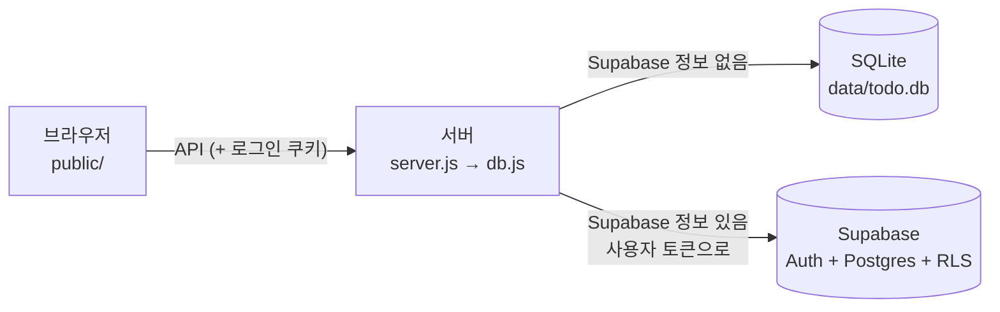

Node.js(Express) 백엔드 하나가 화면 파일을 내보내고, API 요청을 받아 SQLite 또는 Supabase에 저장합니다.

## 구조

화면은 백엔드에만 요청하고, Supabase 주소와 키는 서버의 `.env`에만 있습니다.

| 파일 | 역할 |
|---|---|
| `server.js` | 백엔드: API 창구, 로그인(Supabase 모드), 규칙 검사 |
| `db.js` | DB 입구: `.env`를 보고 SQLite 또는 Supabase 쪽을 고른다 |
| `db/sqlite.js` | SQLite 모드 DB 코드 |
| `db/supabase.js` | Supabase 모드 DB 코드 (함수 이름·인자는 sqlite.js와 같다) |
| `supabase.js` | 요청마다 그 사용자로 Supabase에 접속 (httpOnly 쿠키) |
| `db/supabase/` | 표·RLS·함수 SQL (Supabase SQL Editor에서 실행) |
| `public/` | 화면. 백엔드 API에만 요청한다 |
| `public/demo-api.js` | GitHub Pages 데모용 가짜 백엔드 |
| `scripts/rls-check.mjs` | 계정 두 개로 RLS 확인 (`npm run check:rls`) |
| `render.yaml` | Render 운영 서버 설정. 비밀값은 키 이름만 |

## DB

표 2개, `todos 1 : N tasks`입니다. SQLite 모드는 같은 모양에서 `user_id`만 없습니다.

| 표 | 열 | 메모 |
|---|---|---|
| todos | id, user_id, title, due_date, completed, completed_at | `user_id`는 Supabase Auth 사용자 |
| tasks | id, todo_id, title, completed | `todo_id`는 NOT NULL, 할 일을 지우면 함께 지워진다 |

- 중복 제목은 Supabase에서 DB 색인(UNIQUE)으로 막습니다.
- 여러 행을 한 번에 바꾸는 처리는 DB 함수로 묶었습니다.

## 보안

| 무엇을 | 어떻게 |
|---|---|
| 다른 사람의 할 일 | RLS로 로그인한 사용자가 자기 행만 조회·추가·수정·삭제 |
| DB 접속 | 서버는 관리자 키 없이 사용자 토큰으로만 DB를 부른다 |
| 로그인 토큰 | httpOnly 쿠키에 둔다 (화면 스크립트에서 읽을 수 없다) |
| SQL 주입 | 파라미터화 쿼리만 사용 |
| 규칙 우회 | 화면에서 막는 규칙을 백엔드와 DB 제약조건에서 다시 검사 |
| 비밀값 | `.env`와 Render 환경변수에만. `.env`, `data/*.db`는 Git에 올리지 않는다 |

## 테스트

| 명령 | 확인하는 것 |
|---|---|
| `npm test` | 기본 기능 14가지: CRUD, 규칙, 재시작 후 유지, 90일 자동 삭제 (임시 DB) |
| `npm run check:rls` | 계정 두 개로 서버 API와 Supabase 직접 호출 양쪽에서 RLS 확인. 2026-10-31 기준 19/19 통과 |

## 배포

| 대상 | 방식 |
|---|---|
| 데모 | main에 push하면 GitHub Actions가 `public/`을 GitHub Pages에 올린다. 서버 없이 `demo-api.js`가 예시 데이터로 대신 응답한다 |
| 운영 서버 | Render Blueprint(`render.yaml`). Free 플랜, `npm start`. main에 push하면 자동 재배포. 무료 서버라 한동안 안 쓰면 첫 접속이 느리다 |

자세한 내용은 저장소의 [docs/](https://github.com/eple-lab/todo/blob/main/docs/README.md)에 있습니다.
